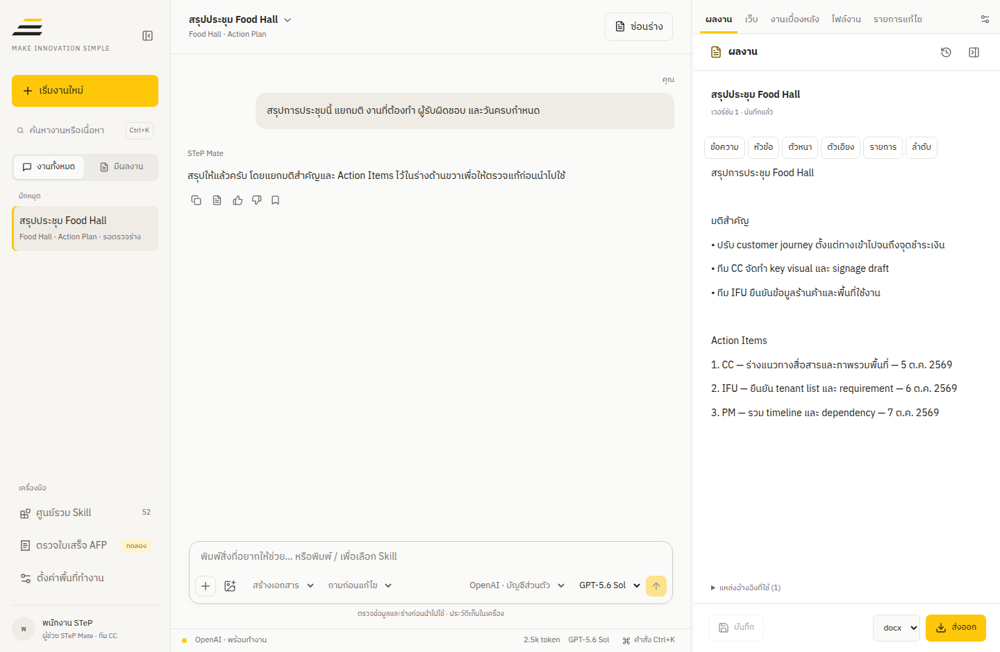
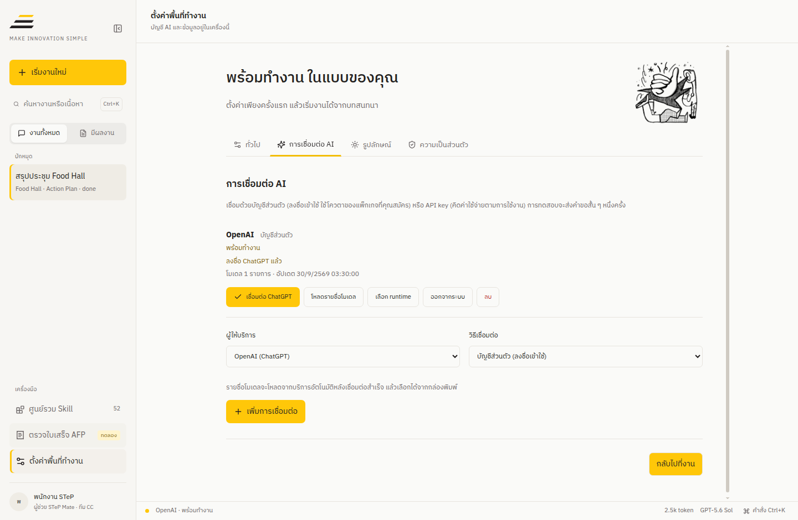
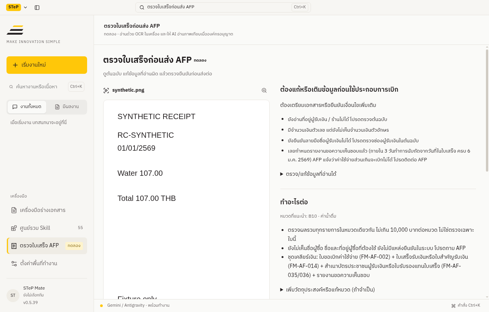

# STeP Desktop

**คุยกับ AI ทำร่าง และเปิดไฟล์ไปทำงานต่อได้ในแอปเดียว**

สำหรับพนักงาน STeP / RSP North ที่ต้องสรุปประชุม เตรียมเอกสาร จัดข้อมูล หรือดูความครบถ้วนของใบเสร็จก่อนส่ง AFP คุณเริ่มจากต้นเรื่องที่มี ตรวจร่างในแอป แล้วส่งออกไปใช้ต่อ

[ดูตัวติดตั้ง Windows / Mac](https://github.com/iisara555/STeP-AI-Harness/releases/tag/desktop-v0.6.17) · [เริ่มใช้งาน](#เริ่มใช้งาน) · [ขอความช่วยเหลือ](../SUPPORT.md)

ภาพใช้ข้อมูลตัวอย่าง หน้าจอและตัวเลือกอาจต่างตามรุ่นและการตั้งค่าขององค์กร

Desktop **0.6.17** เลือกสิทธิ์ Google Workspace ทุกบริการได้เอง เพิ่มคำถามแทรกและงานต่อเนื่อง ปรับฟอร์ม Vault และกล่องยืนยันให้อ่านง่าย พร้อมทบทวนบทเรียนอัตโนมัติที่ผู้ใช้ปิดได้ บัญชี Google เดิมต้องเลือกบริการและยืนยันสิทธิ์เพิ่มกับ Google ก่อนใช้

Desktop **0.6.15** กดปุ่มเข้าสู่ระบบเว็บอย่าง STeP MBS ให้เองหลังกรอกบัญชีจาก Vault ไม่ต้องสลับไปกดเอง

Desktop **0.6.14** ตอบเรื่อง STeP จากคู่มือคุณภาพ QP และ Master List ได้ ตรวจคำตอบกับเอกสารองค์กรให้อัตโนมัติ เพิ่มเมนูแจ้งปัญหา / เสนอแนะ ปุ่มลองใช้ Skill เหนือช่องแชท การ์ดสรุปเช้านี้จาก Google Calendar และ Tasks และปุ่มเพิ่ม Skill ของฉันพร้อมเครดิตผู้เพิ่ม

Desktop **0.6.13** รวมการเลือก AI โมเดล และระดับการคิดไว้ในปุ่มเดียว ทำแถบเครื่องมือผลงานเป็นไอคอน เพิ่มหน้างานตั้งเวลาให้ผู้ช่วยทำงานซ้ำตามเวลาที่ตั้ง ให้ AI ใช้บัญชีเว็บที่บันทึกใน Vault เข้าระบบอย่าง STeP MIS หลังคุณยืนยัน และถามเรื่องนัด งาน หรืออีเมลด้วยภาษาปกติเมื่อเชื่อม Google Workspace

Desktop **0.6.12** ปรับหน้าจอและการตั้งค่าให้อ่านง่ายขึ้นทั้งหน้าต่างเล็กและโหมดมืด ให้พื้นที่ร่างมากขึ้น เพิ่มการค้นงานเก่าและตรวจความจำบนเครื่อง เลือกระดับการคิดตามขนาดงาน และให้ Calendar ขอสิทธิ์อ่านอย่างเดียวเป็นค่าเริ่มต้น ผู้ที่เคยเชื่อม Calendar ให้เชื่อมใหม่หนึ่งครั้ง

Desktop **0.6.11** ร่างเอกสารต่อในแชตได้โดยไม่เริ่มงานใหม่ ส่งภาพและ PDF สแกนให้ AI ได้มากขึ้น ตรวจ Skill ที่นำเข้ากับมาตรฐาน v2 และความปลอดภัยอัตโนมัติ ให้ใช้ Skill ของตัวเองบนเครื่องตัวเองได้เมื่อผ่านการตรวจ และมีปุ่ม "เสนอให้องค์กรใช้" ส่ง Skill ให้ผู้ดูแลพิจารณาผ่านช่องทางรับของ STeP

Desktop **0.6.10** เพิ่มการจัดหน้า DOCX ภาษาไทยสามรูปแบบ พร้อมฟอนต์สารบรรณที่ฝังในไฟล์ ตัวแก้ไขรองรับหัวข้อสามระดับ รายการซ้อน รูปภาพและคำบรรยาย รวมถึงสารบัญ หัวท้ายกระดาษ และเลขหน้าของ Word รักษาโครงหน้าแม่แบบหน่วยงานและเก็บข้อความต้นฉบับในแอปตามเดิม

Desktop **0.6.9** เพิ่ม Skill ช่วยใช้ Google Workspace ผ่านบัญชีที่เชื่อมในแอป ปรับบรรทัดและรูปแบบอักษรไทยในเอกสาร และร่าง TOR ตามการใช้งาน ข้อจำกัด และรูปแบบที่ผู้ใช้ต้องการ การเชื่อม Google Workspace ยังเป็นตัวเลือกแยก และตรวจนโยบายองค์กรกับสิทธิ์ของ Vault ตามเดิม

Desktop **0.6.2** มีหน้า "สื่อภายใน" สร้าง Prompt ภาพสำหรับสื่อสารภายในตามสีองค์กร พร้อมตัวอย่างการจัดวาง และแถบด้านซ้ายย่อเหลือไอคอนที่ขยับเมื่อชี้ได้

Desktop **0.5.39** เตรียม Claude Code ไว้สำหรับข้อความถัดไป พร้อม fallback เมื่อยังไม่ได้ส่งคำถาม และปิด process ที่รอเมื่อออกจากระบบ ปิดแอป หรือเปลี่ยนนโยบาย โหมดนักพัฒนาปิดเป็นค่าเริ่มต้น ต้องให้ผู้ดูแลอนุญาต `features.developmentMode` แล้วคุณเปิดใช้เอง จึงทดสอบแพ็กเกจ Claude ส่วนตัวได้ ดู [วิธีเปิดและข้อจำกัด](../docs/claude-subscription.md#โหมดนักพัฒนา-development-mode) ผลตรวจรุ่นนี้ใช้ข้อมูลสังเคราะห์ ยังไม่ยืนยันความเร็วหรือการเข้าใช้บัญชีจริง

Desktop **0.5.38** เพิ่ม `web_extract` ดึงหัวข้อ ตาราง และลิงก์จากเว็บ, `vision_analyze` / `browser_vision` อ่านภาพหลังคุณยินยอม และ `image_generate` ในแชต การอ่านภาพต้องใช้ connection และนโยบายที่รองรับ; การสร้างภาพใช้ OpenAI/Gemini API (OAuth อย่างเดียวใช้ไม่ได้) เปิดประวัติเครื่องมือดูรหัสตรวจสอบได้โดยไม่บันทึก input/output ของเครื่องมือใน trace ส่วน Google Workspace ใช้ MCP server ขององค์กรที่ผู้ดูแลตั้งค่าและขอ consent แยกตอนค้นหา/เรียกใช้: [วิธีตั้งค่า](../docs/desktop-automation.md#google-workspace-through-an-organization-mcp-server) ผลทดสอบใช้ข้อมูลสังเคราะห์ ยังไม่ยืนยันคุณภาพกับโมเดลจริงหรือสิทธิ์บัญชี Google ขององค์กร

## เริ่มใช้งาน

Desktop **0.5.38** เพิ่มค้นเว็บสาธารณะให้ทุก connection รวม Antigravity ผ่าน Bing โดยไม่ต้องเพิ่ม API key (ต้องเปิด tool loop และอนุญาตเว็บไซต์; กฎข้อมูล/สิทธิ์เดิมยังใช้) และปรับหน้า OCR เป็นหน้าเดียว: เลือกเอกสาร → เทียบข้อมูล → ยืนยัน → ให้ AI ตรวจทานต่อ การส่งต่อใช้ข้อมูลข้อความพร้อม provenance ไม่ส่งภาพในขั้นตอนนี้ ข้อมูลยาวระบุหลักฐานที่ละไว้; ผลตรวจฉบับเต็มบันทึกเก็บในเครื่องได้ ผลทดสอบรอบนี้ใช้ข้อมูลสังเคราะห์ ยังไม่ยืนยันความแม่นยำกับเอกสารจริง

### ติดตั้งให้ตรงกับเครื่อง

สำหรับงานของหน่วยงาน ให้ใช้ตัวติดตั้งที่ผู้ดูแลอนุมัติและแจกผ่านช่องทางภายใน ส่วน [หน้า Desktop releases](https://github.com/iisara555/STeP-AI-Harness/releases?q=desktop-v) ใช้ดูรุ่นและไฟล์ที่เผยแพร่

| เครื่องที่ใช้ | ไฟล์ที่เลือก | วิธีติดตั้ง |
| --- | --- | --- |
| Windows x64 | `STeP-Desktop-Setup-<รุ่น>.exe` | เปิดไฟล์แล้วทำตามหน้าจอ |
| Mac Apple Silicon เช่น M1 / M2 / M3 | `STeP-Desktop-<รุ่น>-arm64.dmg` | เปิด DMG แล้วลากแอปไป Applications |
| Mac Intel | `STeP-Desktop-<รุ่น>-x64.dmg` | เปิด DMG แล้วลากแอปไป Applications |

**เปิดบน Mac ครั้งแรก:** รุ่นปัจจุบันยังไม่มีการรับรองด้วย Apple Developer macOS อาจแจ้ง “Apple could not verify…” ให้ตรวจแหล่งที่มา กด Done แล้วไปที่ **System Settings → Privacy & Security → Open Anyway** หากมีข้อความอื่น ให้เปิด **อ่านก่อนเปิดครั้งแรก.html** ที่อยู่ใน DMG เพื่อดูวิธีตรงกับอาการ อย่าข้ามคำเตือนให้ไฟล์ที่ไม่ทราบแหล่งที่มา

### ตั้งค่าแล้วเชื่อมบัญชี AI

เปิดแอปและทำ **Setup Wizard ครั้งแรก** ตั้งชื่อเรียก ทีม ผู้ช่วย และโฟลเดอร์งาน จากนั้นเลือก AI เชื่อมต่อ และรอผลทดสอบข้อความสั้น ๆ เมื่อผ่านแล้วจึงเริ่มทำงาน การทดสอบนี้ใช้โควตาของบัญชี

เลือกบริการที่องค์กรอนุมัติและบัญชีที่คุณมีสิทธิ์ใช้:

| บริการ | วิธีเชื่อมต่อที่ควรรู้ |
| --- | --- |
| **ChatGPT** | ลงชื่อผ่านเบราว์เซอร์ ใช้ตามสิทธิ์และโควตาของแพ็กเกจ |
| **Gemini ผ่าน Antigravity** | ลงชื่อด้วย Google สำหรับบัญชีที่มีสิทธิ์ ช่องทางนี้ยังเป็นการทดลอง |
| **Gemini API** | ใช้คีย์จาก Google AI Studio มีโควตาและค่าใช้จ่ายแยกจากแพ็กเกจ Google |
| **Claude** | ใช้ API หรือ Claude Console ส่วนแพ็กเกจผ่าน Claude Code ในแอปต้องมีโปรแกรมนั้นและให้ผู้ดูแลเปิดฟังก์ชันก่อน |
| **บริการอื่น** | เปิดตัวเลือกเพิ่มเติม เช่น OpenRouter หรือบริการ API ที่องค์กรอนุมัติ |

ลงชื่อสำเร็จแต่ทดสอบไม่ผ่าน ให้ลองทดสอบบัญชีเดิมก่อนเพิ่มการเชื่อมต่อใหม่ ค่าใช้จ่ายและโควตาขึ้นกับผู้ให้บริการ หากเชื่อม Antigravity การตัดการเชื่อมต่อใน STeP ไม่ได้ออกจากบัญชี Google ในโปรแกรมนั้น จึงควรตรวจบัญชีก่อนใช้เครื่องร่วมกัน

### ลองงานแรก

กด **เริ่มงานใหม่** แล้วพิมพ์:

> สรุปการประชุมนี้ แยกมติ งานที่ต้องทำ ผู้รับผิดชอบ วันครบกำหนด และเรื่องที่ยังรอยืนยัน

แนบต้นเรื่องที่มีสิทธิ์ส่ง รอคำตอบ แล้วเปิด **ผลงาน** เพื่อตรวจและแก้ร่าง เปลี่ยนเรื่องให้เริ่มงานใหม่ ถ้าต้องการแนวทางงานเฉพาะ เลือก **ศูนย์รวม Skill** หรือพิมพ์ `/` การเลือก Skill ให้อัตโนมัติขึ้นกับการตั้งค่าขององค์กร

## จากร่างในแอป ไปทำงานต่อใน Word, Excel หรือ PowerPoint

| ผลงานที่ต้องการ | วิธีใช้ต่อ |
| --- | --- |
| หนังสือหรือเอกสาร | ส่งออก DOCX เพื่อแก้ข้อความและตารางต่อ หรือ PDF เพื่อตรวจหน้า |
| ตารางข้อมูลหรือแผนงาน | ส่งออก XLSX แล้วเปิดตรวจใน Excel หรืออัปโหลดเข้า Google Sheets |
| สไลด์นำเสนอ | ส่งออก PPTX แล้วเปิดตรวจและจัดหน้าต่อใน PowerPoint |
| ข้อความที่ต้องย้ายไปใช้อีกที่ | คัดลอกข้อความหรือส่งออก Markdown |

เมื่อ AI เสนอแก้ไฟล์ในโหมดถามก่อนแก้ ให้ตรวจใน **รายการแก้ไข** แล้วจึงใช้การแก้ไข การสร้างไฟล์ใหม่ไม่ได้แทนการตรวจสูตร ผลคำนวณ หรือหน้าสไลด์ และไม่ได้แก้รูปแบบ PowerPoint เดิมให้เหมือนต้นฉบับทุกส่วน

เมื่อเปิดตัวอย่าง HTML ในแถบผลงาน เลือก **พอดีพื้นที่** เพื่อดูสไลด์หรือหน้าที่มีขนาดตายตัวให้ครบ หรือ **ขนาดจริง** เพื่อดูขนาดเดิม เอกสารที่จัดหน้าแบบ responsive จะปรับตามความกว้างแถบและเลื่อนอ่านต่อได้ ตัวเลือกนี้ปรับเฉพาะการแสดงตัวอย่าง ไม่แก้ไฟล์ต้นฉบับ

## เครื่องมือร่างเอกสาร

เลือก **เครื่องมือร่างเอกสาร** → เลือกชนิด → กรอกข้อมูลหรือแนบต้นเรื่อง → **ให้ AI ร่างเอกสาร** → ตรวจและเลือก **ใช้ร่างนี้** → แก้ไขและส่งออก

มี 5 เครื่องมือ: **TOR, บันทึกข้อความ, หนังสือราชการ, โครงการ และรายงานการประชุม** แต่ละเครื่องมือใช้ Skill แม่แบบ และกติกาตรวจข้อมูลของงานนั้น ข้อมูลที่ไม่มีต้นทางต้องคงช่อง `[รอยืนยัน: …]` ไม่เติมเลขหนังสือ งบประมาณ ข้อกฎหมาย หรือผู้ลงนามขึ้นเอง

แก้ร่างต่อผ่านแชตได้ เช่น “ชื่อโครงการ: …” หรือ “ปรับวัตถุประสงค์…” ระบบใช้ร่างปัจจุบันพร้อม Skill และแม่แบบเดิมเป็นฐาน ตรวจข้อเสนอแล้วเลือก **ใช้ร่างนี้** ก่อนส่งออก ข้อมูลและผลตรวจยังแยกจากตัวเอกสาร

### ใช้แม่แบบจาก MIS

สำหรับ **บันทึกข้อความ หนังสือราชการ โครงการ และรายงานการประชุม** ดาวน์โหลดแม่แบบ DOCX ที่ตรงงานจาก [คลัง MIS](https://mis.step.cmu.ac.th/sMIS/iso.php) ด้วยบัญชีที่มีสิทธิ์ แล้วแนบในเครื่องมือร่าง เลือก **แบบฟอร์ม / ตัวอย่าง** (ไฟล์ DOCX จะเลือกให้อัตโนมัติ) กรอกข้อมูลของงานใหม่ในช่องฟอร์ม ส่วน **TOR ใช้แบบ 16 หัวข้อเดิม**

AI ได้รับโครงและชื่อช่องที่ระบบรองรับ แทนข้อความตัวอย่างเดิม ไฟล์แม่แบบเก็บเฉพาะในเครื่อง เมื่อส่งออก **DOCX** แอปใช้ฟอนต์ ระยะขอบ ตาราง เซลล์รวม ตรา หัว/ท้ายกระดาษ และแนวหน้าของแบบที่เลือก พร้อมข้อความล่าสุดในร่าง หากตารางไม่ตรงแบบ แอปจะแจ้งให้แก้ก่อนส่งออก ข้อมูลในร่างยังอยู่ครบ

เลือกแม่แบบเปล่าที่ถูกประเภทและตรวจรุ่นกับเจ้าของแบบก่อนใช้ เอกสาร MIS ไม่รวมในตัวติดตั้งหรือ repo สาธารณะ หากไม่แนบ DOCX จะใช้แบบร่างทั่วไปซึ่งต้องเทียบกับแบบหน่วยงานอีกครั้ง

### ฟอนต์ ตราครุฑ และการนำไปใช้ต่อ

**เมื่อใช้แม่แบบ DOCX:** รักษาฟอนต์และตราที่อยู่ในต้นฉบับ แอปไม่เพิ่มตราซ้ำและไม่ติดตั้งฟอนต์ให้อัตโนมัติ ติดตั้งฟอนต์ที่แบบระบุ เปิด DOCX ใน Word เพื่อตรวจทุกหน้า แล้วจึงบันทึก PDF จาก Word หากต้องการ

**เมื่อใช้แบบร่างทั่วไป:** บันทึกใช้ TH Sarabun New และครุฑสูง 1.5 ซม. ที่ซ้ายหน้าแรก หนังสือใช้ TH Sarabun PSK และครุฑสูง 3 ซม. กลางหน้าแรก TOR โครงการ และรายงานประชุมไม่ใส่ตราอัตโนมัติ เปลี่ยนฟอนต์หรือเลือกไม่ใส่ตราได้ ดู [ที่มาของภาพและขนาด](../docs/third-party-notices/thai-garuda.md)

ตัวเอกสารกับผลตรวจ AI แสดงแยกกัน ตารางตรวจ Skill และรายการข้อมูลที่ต้องยืนยันจะไม่ติดไปในไฟล์ส่งออก ช่องข้อมูลที่ขาดในตัวเอกสารยังคงรอยืนยัน ตรวจชื่อ วันที่ ตัวเลข ข้อกฎหมาย และผู้ลงนามก่อนใช้จริง การเลือกแม่แบบไม่ได้ยืนยันข้อมูลหรืออนุมัติเอกสารให้

ตอนแนบต้นเรื่องของงานนี้ให้เลือก **ต้นเรื่องของงานนี้** เพื่อให้ AI ใช้ข้อความประกอบการร่าง หากแนบแม่แบบ กรอกข้อมูลใหม่ในฟอร์มแยกจากค่าตัวอย่าง ใช้ได้หนึ่งไฟล์ต่อร่าง

ถ้ายังไม่มีโฟลเดอร์ทำงาน กด **ส่งออก** แล้วเลือกหรือสร้างโฟลเดอร์ได้ทันที แอปจะจำโฟลเดอร์สำหรับงานต่อไป หากกดยกเลิก ร่างยังอยู่ การส่งออกไม่ส่งเอกสารหรือภาพให้ AI เพิ่ม

## ตรวจใบเสร็จก่อนส่ง AFP

เปิด **ตรวจใบเสร็จ AFP** ดูต้นฉบับทางซ้าย ผลตรวจทางขวา หน้าต่างแคบเรียงเป็นคอลัมน์เดียว ผลตรวจมีเพียงสามส่วน: **ต้องแก้หรือเติมข้อมูลก่อนใช้ประกอบการเบิก**, **ทำอะไรต่อ**, และ **ดูองค์ประกอบพื้นฐานใบเสร็จ**

1. เลือก PDF หรือภาพใบเสร็จ หากต้องใช้ OCR ในเครื่อง กด **ติดตั้ง OCR** ครั้งแรก แล้ว **เปิดบริการ OCR** เมื่อจำเป็น
2. ดูจุดที่ขาดหรือขัดกัน เปิด **ตรวจ/แก้ข้อมูลที่อ่านได้** แล้วเทียบทุกค่ากับต้นฉบับ แก้ช่องที่อ่านผิด รวมรายการ ที่อยู่ จำนวนเงินตัวอักษร และลายเซ็น
3. ดูขั้นตอนถัดไป หมวดเบิกเป็นคำแนะนำ หากต้องแก้หมวดหรือเพิ่มวัตถุประสงค์ เปิด **เพิ่มวัตถุประสงค์หรือแก้หมวด (ถ้าจำเป็น)**
4. ติ๊ก **ตรวจทั้งหมดเทียบกับต้นฉบับแล้ว** ครั้งเดียว การแก้ข้อมูลจะถอนการยืนยัน
5. เลือก AI ที่พร้อมใช้งาน แล้วกด **ให้ AI ตรวจทานต่อ** หรือบันทึกผลตรวจเก็บไว้ หากส่งล้มเหลว ข้อมูลยังอยู่และลองใหม่ได้ ขั้นตอนนี้ส่งเฉพาะผลตรวจและข้อความ ไม่ส่งภาพต้นฉบับ

องค์ประกอบพื้นฐานแสดงชื่อและที่อยู่ผู้รับเงิน วันที่ รายการค่าใช้จ่าย จำนวนเงินตัวเลขและตัวอักษร และลายเซ็นผู้รับเงิน แยก **พบข้อมูล / ขาด / รอตรวจ** การพบลายเซ็นไม่รับรองตัวผู้ลงชื่อ และองค์ประกอบครบไม่ได้อนุมัติเบิก เงื่อนไขแต่ละประเภทและหมวดเบิกต้องยืนยันกับ AFP

**วิธีอ่านขึ้นกับบริการและสิทธิ์องค์กร:** OCR ในเครื่องเป็นส่วนเสริมที่ดาวน์โหลดเมื่อติดตั้ง ภาพไม่ถูกส่งไปบริการ OCR ภายนอก บริการที่รองรับภาพอาจอ่านด้วย AI ได้โดยไม่ติดตั้ง OCR หลังคุณยินยอมส่งภาพ การเปิด privacy checks จะปิดการส่งภาพใบเสร็จให้ AI ส่วน **Antigravity, compatible endpoints และ Copilot ใช้ข้อความ** จึงต้องมี OCR ก่อน AI ช่วยเลือกตัวเลือก OCR หลัง consent แต่ไม่สามารถกู้ข้อความที่ OCR ไม่ได้อ่านจากภาพ ค่าที่คุณแก้เองจะไม่ถูก AI ที่ตอบช้าทับ

ค่าที่ตรวจเทียบต้นฉบับแล้วใช้ `SOURCE_FACT`; ค่าที่กรอกเองแต่ยังไม่ตรวจใช้ `USER_INPUT`; ผล OCR/AI ดิบและตัวเลือกยังเป็น `EXTRACTED_UNVERIFIED` ไม่มีเครื่องมือทดลองขั้นสูงบนหน้าพนักงาน ดู [เกณฑ์ทดลอง OCR](../experiments/local-thai-ocr/TEST-PLAN.md) และ [benchmark สำหรับผู้ดูแล](../experiments/local-thai-ocr/benchmark/README.md) ผลทดสอบสังเคราะห์ยังไม่รับรองความแม่นยำกับเอกสารจริง

## สร้างภาพจากข้อความ

เลือก **สร้างรูป** ใช้บัญชี **OpenAI API หรือ Gemini API** เลือกโมเดลภาพที่บัญชีมีให้ใช้ แล้วระบุรายละเอียดภาพให้ครบ ตรวจผลใน **ผลงาน** และกด **บันทึกรูป** เมื่อเลือกได้ ค่าใช้จ่าย API แยกจากแพ็กเกจ ChatGPT หรือ Google

เส้นทางนี้สร้างภาพใหม่จากข้อความ ยังไม่รองรับแก้ภาพเดิมหรือแนบภาพอ้างอิง หากต้องการสรุปเป็นข้อความ ให้ใช้คำว่า **สรุปภาพรวม** เพราะคำว่า **สร้างภาพรวม** อาจถูกเลือกเป็นงานสร้างภาพเมื่อเปิดการเลือกงานอัตโนมัติ สำหรับคำขอภาพครั้งถัดไป ให้พิมพ์รายละเอียดครบอีกครั้ง เพราะระบบยังไม่รวมรายละเอียดจากคำขอก่อนหน้าให้

## ดูการใช้งานและเครดิต

พิมพ์ `/usage` เพื่อดูการใช้งานที่แอปบันทึก และโควตาหรือเครดิตจากบัญชีที่รองรับ บางบริการแสดงช่วงเวลา 5 ชั่วโมง รายสัปดาห์ หรือยอดเครดิต บางบัญชีมีเพียงข้อมูลในเครื่องหรือลิงก์ของผู้ให้บริการ ตัวเลขประมาณการในแอปไม่ใช่ใบเรียกเก็บเงินจริง

## ก่อนส่งข้อมูลและก่อนใช้ผลงาน

ประวัติงานและร่างเก็บในเครื่อง แต่การคุยกับ AI ออนไลน์ส่งข้อมูลไปยังบริการที่เลือก ใช้เฉพาะข้อมูลที่คุณมีสิทธิ์ส่ง การตรวจและปิดบังข้อมูลอัตโนมัติขึ้นกับการตั้งค่าขององค์กร ไม่ได้เปิดทุกกรณี

ห้ามใส่รหัสผ่าน คีย์ลับ token cookie หรือรหัส MFA ในบทสนทนา ตรวจชื่อ วันที่ ตัวเลข แหล่งอ้างอิง และส่วนที่รอยืนยันก่อนนำร่างไปใช้ การอนุมัติ ลงนาม เบิกจ่าย และรับรองงานเป็นหน้าที่ของผู้มีอำนาจ

## อัปเดตแอป

แอปตรวจอัปเดตเป็นระยะเมื่อเปิดใช้ฟังก์ชันนี้ไว้ กดเลขรุ่นใต้ชื่อผู้ใช้เพื่อตรวจทันที เมื่อดาวน์โหลดพร้อม ให้กด **รีสตาร์ทเพื่ออัปเดต** หลังตรวจและบันทึกงานที่กำลังทำ

หากดาวน์โหลดหรืออัปเดตไม่สำเร็จ ให้กดลองอีกครั้งในแอป บน Mac ควรวางแอปใน Applications ที่มีสิทธิ์เขียนได้ หากแอปแจ้งให้ติดตั้งเอง ให้ใช้รุ่นจากช่องทางที่ผู้ดูแลอนุมัติ การอัปเดตตามปกติเก็บประวัติและร่างไว้

## ถอนการติดตั้ง

- **Windows:** Settings → Apps → STeP Desktop → Uninstall ค่าเริ่มต้นเก็บประวัติและการตั้งค่าไว้ หากต้องการลบด้วย ให้เลือกช่องลบข้อมูลในตัวถอนการติดตั้ง
- **Mac:** ลากแอปจาก Applications ไปถังขยะ ประวัติและการตั้งค่ายังอยู่ หากต้องการลบ ให้ลบโฟลเดอร์ `~/Library/Application Support/STeP Desktop` แยกต่างหาก

ไฟล์ผลงานในโฟลเดอร์งานและโปรไฟล์ที่ใช้ร่วมกับ STeP Skills ไม่ถูกลบโดยการถอนแอป

## เมื่อมีปัญหา

แจ้งรุ่นแอป Windows / Mac ที่ใช้ บริการ AI และข้อความผิดพลาด พร้อมภาพหน้าจอที่ปิดบังข้อมูลอ่อนไหว ผ่าน [STeP AI Support](../SUPPORT.md)

อ่าน [ภาพรวม STeP AI](../README.md) หรือ [รายละเอียดสำหรับผู้ดูแลและนักพัฒนา](../docs/desktop-development.md) เมื่อต้องตั้งค่าระบบ ทดสอบ หรือสร้างตัวติดตั้ง

รุ่นใน source: **STeP Desktop v0.6.17** ดูไฟล์ที่เผยแพร่จาก [Desktop releases](https://github.com/iisara555/STeP-AI-Harness/releases?q=desktop-v) การมี release ไม่ได้แทนการอนุมัติใช้งานในหน่วยงาน
