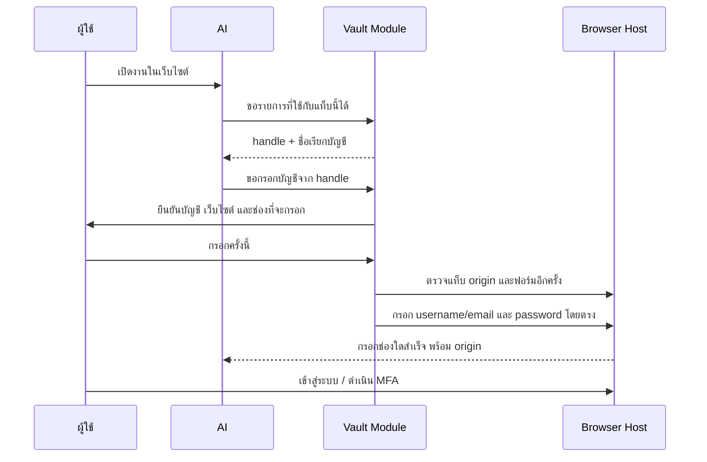

# STeP Vault — แบบระบบและหน้าจอ

สถานะ: ข้อเสนอการออกแบบ ยังไม่ได้ implement หรือเปิดใช้ในแอป

วันที่: 14 ตุลาคม 2026 · อ้างอิง STeP Desktop 0.6.3 / main `81fe787727487ab654701a19e55039750db76345`

**ข้อเสนอ:** ทำ Vault ส่วนตัวบนเครื่อง ให้เก็บ **username/email พร้อม password** และ API key ได้ ผู้ใช้เลือกบัญชีและอนุญาตการใช้ ส่วนโปรแกรมนำค่าจริงไปกรอกหรือยืนยันตัวตนกับปลายทางที่กำหนด โมเดลได้รับเพียงชื่อเรียกบัญชี หมายเลขอ้างอิง และผลการทำงาน

## สำหรับผู้มาพัฒนาต่อ

เอกสารนี้เป็น design handoff สำหรับ review และแยกงาน implementation ยังไม่มี Vault code, schema migration หรือ feature flag ใหม่ใน PR นี้ การรองรับ username/email คู่กับ password เป็น requirement ที่ผู้ใช้ยืนยัน ส่วนรายละเอียดกลไกเข้ารหัสและ execution gate เป็นข้อเสนอที่ต้องทบทวนด้าน implementation/security ก่อนเปิดใช้

- [ ] **P0:** เพิ่ม regression ที่มี watchdog และ profile คงที่เพื่อแยก shutdown/persistence; พิสูจน์ packaged Windows/Mac และ upgrade ก่อนกล่าวว่าเก็บข้ามการเปิดแอปได้
- [ ] **P1:** ทำ Vault Module และ Settings โดยเริ่มจาก encrypted username+password, metadata-only Interface, secure IPC และ migration ที่รักษาข้อมูลเดิม
- [ ] **P2:** Implement browser list/fill/request_save, username-first login, exact-origin checks, approval binding, execution isolation and redaction with adversarial tests.
- [ ] **P3:** เชื่อม external password managers หลัง MVP ผ่าน โดยผู้ใช้เลือกเปิดแหล่งข้อมูลเอง

เริ่มจาก P0 และเปิด implementation PR แยกตาม milestone เพื่อให้ review ได้เป็นเรื่องเดียว ใช้ fixture สังเคราะห์และบัญชีทดสอบที่ได้รับอนุญาตเท่านั้น ผล security tests 7 ข้อที่กล่าวท้ายเอกสารเป็นผลตรวจฐานเดิม ไม่ใช่ผลทดสอบ Vault ใหม่ ชุด benchmark เดิมไม่มีงบอนุมัติเพิ่มจากงานนี้

Employee Google Workspace account connection and Google service access are specified in the [Google Workspace design handoff](desktop-google-workspace-design.md). It covers the existing organization MCP route, a future native OAuth route, service capabilities, administrator controls and G0-G3 acceptance. Google service grants remain separate from AI-provider sign-in and browser password fill.

## 1. สิ่งที่อ้างอิงจาก Hermes และสิ่งที่เลือกให้ STeP

Hermes มีหน้าจอจัดการ credential ใช้ handles สำหรับเลือกข้อมูล แล้วกรอกผ่าน browser host โดยตรวจ origin ก่อนและระหว่างกรอก ผลเครื่องมือไม่คืน password และมีเส้นทางเชื่อม password manager ภายนอกได้ ดู [คู่มือ Passwords & Logins](https://hermes-agent.nousresearch.com/docs/user-guide/features/credential-vault) และ [browser_vault_tool.py](https://github.com/NousResearch/hermes-agent/blob/d97007c32d6340f7ba79ac1dfb5773cc00846448/tools/browser_vault_tool.py)

แบบของ STeP เลือกดังนี้:

| เรื่อง | พฤติกรรมที่เสนอ |
| --- | --- |
| บัญชีเข้าเว็บไซต์ | เก็บ username หรือ email **คู่กับ password** และกรอกทั้งคู่ รองรับหน้าล็อกอินสองขั้น |
| ค่าที่โมเดลเห็น | ชื่อเรียกที่ผู้ใช้ตั้ง เช่น “MIS บัญชีงาน”, handle, origin, สถานะ และชื่อช่องที่กรอกสำเร็จ |
| ข้อมูลบัญชีจริง | username/email และ password อยู่ใน encrypted payload เดียวกัน หน้า Vault แสดง identifier แบบปิดบางส่วนตามค่าเริ่มต้น |
| การเพิ่มข้อมูล | ผู้ใช้กรอกในหน้าต่างเฉพาะของแอป มีช่อง password แบบ masked และเลือกจำบัญชีเอง |
| การใช้กับเว็บ | อนุญาตเป็นครั้ง ระบุเว็บไซต์ บัญชี งาน และช่องที่จะกรอก การส่งแบบฟอร์มเป็นอีกการกระทำที่ต้องได้รับอนุญาต |
| API key | ผูกกับ connection และปลายทางที่อนุมัติไว้ ใช้ authorization เดิมของ connection ไม่ถามใหม่ทุก tool turn |
| MFA / passkey | ผู้ใช้ดำเนินการเอง แอปรอผล ไม่มีการเก็บ MFA/recovery code ในรุ่นแรก |
| ขอบเขต | ส่วนตัวบนเครื่อง Windows x64 / Mac Apple silicon ตามแพลตฟอร์มที่โครงการเผยแพร่อยู่ |
| แหล่งภายนอก | ระยะถัดไปเชื่อม 1Password / Bitwarden แบบผู้ใช้เปิดเอง |

ขอบเขตออกแบบตั้งต้นคือบัญชีส่วนตัวของผู้ใช้ในแอป ส่วนการแชร์ Vault ในทีมต้องมีระบบสิทธิ์จากแหล่งที่เชื่อถือได้ก่อน ค่าเลือกทีมใน Settings ไม่ใช่หลักฐานสิทธิ์เข้ารหัสผ่านของทีม

## 2. หน้าจอที่ผู้ใช้เห็น

ตำแหน่งหลัก: **ตั้งค่าพื้นที่ทำงาน → ความปลอดภัย → รหัสผ่านและการเชื่อมต่อ** มีคำสั่ง local `/vault` และรายการใน command palette สำหรับเปิดหน้าจอนี้ โดยไม่ส่งคำสั่งไปยัง AI

```text
รหัสผ่านและการเชื่อมต่อ                    [+ เพิ่มบัญชี]
เก็บบนเครื่องนี้ · ใช้ได้เฉพาะปลายทางที่คุณอนุญาต

[ค้นหาชื่อบัญชีหรือเว็บไซต์...]
[ทั้งหมด] [เว็บไซต์] [API key] [จัดการผ่านบัญชี AI]

MIS บัญชีงาน                 เว็บไซต์       พร้อมใช้
https://mis.step.cmu.ac.th
ชื่อผู้ใช้: us••••             [แก้ไข] [สิทธิ์] [ลบจากเครื่อง]

ผู้ให้บริการ AI บัญชีงาน       API key        พร้อมใช้
ผูกกับการเชื่อมต่อที่เลือก     [เปลี่ยน key] [สิทธิ์]

กิจกรรมล่าสุด: ชื่อบัญชี · เว็บไซต์ · งาน · ผลการใช้ · เวลา
[พักการใช้ Vault]
```

โดเมน MIS ด้านบนใช้แสดงตำแหน่งข้อมูลในหน้าจอ ไม่ได้ยืนยันว่าเป็น origin ของหน้า SSO จริง การเพิ่มรายการต้องตรวจหน้าเข้าสู่ระบบและบันทึก origin ที่ถูกต้องก่อน

### เพิ่มหรือแก้ไขบัญชีเว็บไซต์

```text
ชื่อเรียกบัญชี       [MIS บัญชีงาน                     ]
เว็บไซต์ที่ใช้ได้     [https://accounts.example.test     ]
รูปแบบบัญชี          [ชื่อผู้ใช้ / อีเมล                ]
Username / อีเมล     [                                  ]
Password             [••••••••••••                      ]

[ ] จำบัญชีนี้บนเครื่องส่วนตัวของฉัน

[ยกเลิก]                                      [บันทึก]
```

- บันทึก username/email และ password เป็นรายการเดียว แก้ไขด้วย revision เดียว ไม่เกิดการจับ username ของบัญชีหนึ่งคู่กับ password ของอีกบัญชี
- ช่องกรอกข้อมูลจริงอยู่ใน trusted app UI เท่านั้น ไม่ใช้กล่อง `ask_user` ปกติที่ส่งคำตอบเข้า conversation
- ค่า password ที่บันทึกแล้วไม่ถูกส่งกลับมาแสดงเพื่อแก้ไข ช่องเปลี่ยนรหัสว่างไว้จนผู้ใช้พิมพ์ค่าใหม่; username แก้ไขได้ผ่านหน้าจอเฉพาะที่ผู้ใช้เปิดเอง
- API key ใช้แบบฟอร์มแยกซึ่งเลือก connection และ destination ที่ยืนยันแล้ว แทนการใส่ปลายทางอิสระให้โมเดล
- เครื่องที่นโยบายกำหนดว่าใช้ร่วมกัน ปิดการจำบัญชีและใช้การลงชื่อด้วยผู้ใช้ตามปกติ

### การขอใช้บัญชีในงาน

```text
ใช้ “MIS บัญชีงาน” กับเว็บไซต์นี้?
เว็บไซต์: https://accounts.example.test
งาน: เปิดข้อมูลที่คุณขอ
ข้อมูลที่จะกรอก: Username และ Password

[ยกเลิก]                            [กรอกครั้งนี้]
```

ข้อความเว็บไซต์และงานมาจาก host ที่ตรวจแล้ว ไม่แสดง HTML ของเว็บไซต์ใน dialog เมื่อกรอกแล้วให้ผู้ใช้กดเข้าสู่ระบบ หรืออนุมัติการส่งแบบฟอร์มผ่านกฎเดิม การอนุญาตกรอกไม่อนุญาตการส่งข้อมูล การจอง การจ่าย หรือการอนุมัติรายการอื่น

คำว่า “พักการใช้ Vault” หมายถึงหยุดการใช้ผ่านแอป ยกเลิก grants และล้าง cache ที่ทำได้ ไม่อ้างว่าเป็นการล็อกด้วย master password หรือยืนยันตัวตนซ้ำผ่าน Windows Hello/Touch ID ฟีเจอร์ยืนยันตัวตนซ้ำเพิ่มได้เมื่อมี native implementation และผลทดสอบของแต่ละแพลตฟอร์ม

## 3. Flow สำหรับ username และ password



เว็บที่แยกสองขั้น:

1. Host ตรวจว่าเป็นหน้ากรอก identifier แล้วขออนุญาตกรอก username/email
2. ผู้ใช้กด Next หรืออนุมัติการส่งฟอร์มตามกฎเดิม
3. Host ตรวจแท็บ origin และฟอร์มของหน้ารหัสผ่านใหม่ ใช้บัญชีเดิมจาก login attempt เดียวกัน และขออนุญาตก่อนกรอก password
4. หากมีการเปลี่ยน origin, navigation, session, บัญชี หรือ policy ระหว่างขั้น ให้ยกเลิก grant เก่าและตรวจใหม่
5. เส้นทาง SSO ที่ต้องข้าม origin ใช้บัญชีหรือ session ของผู้ใช้ก่อน การเพิ่ม origin ใหม่ต้องเป็นการตั้งค่าที่ผู้ใช้ทบทวน ไม่อนุมานจากชื่อโดเมนใกล้เคียง

ผลเครื่องมือตัวอย่าง มีเพียงชื่อช่อง ไม่มีค่าจริง:

```json
{
  "status": "filled",
  "filledFields": ["username", "password"],
  "origin": "https://accounts.example.test"
}
```

`filled` ยืนยันเฉพาะการกรอก ไม่ยืนยันว่าเว็บไซต์รับบัญชี เข้าสู่ระบบสำเร็จ หรือ MFA เสร็จแล้ว

## 4. Vault Module และ Interface

วาง logic ที่ `desktop/electron/vault/` ให้ callers รู้เพียงการจัดการ metadata การขอใช้ และผลลัพธ์ ส่วนการเข้ารหัส การตรวจสิทธิ์ การแข่งขันระหว่างงาน และการส่ง credential ไปยังปลายทางอยู่หลัง Interface เดียว

```text
AI / tools                 Trusted Settings UI
handles + metadata         ใส่ข้อมูลครั้งแรก / เปลี่ยนข้อมูล
       \                          /
                 Vault Module
           policy + grants + audit
                     |
           OS-protected encrypted store
                     |
        Browser Host / Provider transport
                 ส่งผลสถานะกลับ
```

Interface ที่เสนอ (pseudocode สำหรับการออกแบบ):

```ts
interface Vault {
  catalog(query: CatalogQuery, context: TrustedContext): Promise<CredentialSummary[]>;
  manage(command: UserManagementCommand, context: TrustedUserSurface): Promise<ManagementReceipt>;
  execute(intent: CredentialUse, context: TrustedContext): Promise<UseReceipt>;
  suspend(reason: SuspendReason): Promise<void>;
}
```

- `manage`: เพิ่ม/เปลี่ยน/ลบ/กำหนดสิทธิ์ รับค่าใหม่จาก trusted UI และคืน metadata เท่านั้น ไม่มีคำสั่ง read/export plaintext
- `catalog`: รายการที่ใช้ได้ในบริบทปัจจุบัน ใช้ชื่อเรียกบัญชีที่ตรวจแล้ว ไม่ส่ง username/email จริงเข้าโมเดลตามค่าเริ่มต้น
- Labels และ metadata เป็นข้อมูลที่ไม่น่าเชื่อถือใน prompt ต้องแยกจากคำสั่ง ไม่สามารถเปลี่ยน policy หรือสร้างสิทธิ์ผ่านข้อความในชื่อบัญชี
- `execute`: รับ handle และปลายทางที่ host ผูกไว้ เลือกได้เฉพาะ sink ที่รองรับ ไม่รับ callback, คำสั่ง shell, URL อิสระ หรือ script จากโมเดล
- `suspend`: ปิดการใช้ ยกเลิก grants ที่รอ และล้างค่าชั่วคราวเท่าที่ runtime ทำได้ JavaScript strings ไม่รับประกันการล้างหน่วยความจำทุกสำเนา
- `TrustedContext`: สร้างโดย host จาก profile, session, workspace, policy revision และ tab/connection จริง ห้ามรับค่าเหล่านี้จากคำกล่าวอ้างของโมเดล
- ข้อมูลใน `manage` อาจอยู่ชั่วคราวในหน่วยความจำของ UI ตอนผู้ใช้กรอก หลังบันทึกไม่มี Interface สำหรับอ่านค่าจริงกลับจาก store

เครื่องมือที่ AI เห็น: `browser_vault` มี `list`, `fill`, `request_save` โดย `request_save` เปิด secure UI เท่านั้น พารามิเตอร์ที่มี password, username, secret หรือ payload ของฟอร์มถูกปฏิเสธ ไม่ให้โมเดลเขียนข้อมูลเหล่านี้เอง

ใช้ `tool_search` / `tool_describe` เดิมสำหรับค้นเครื่องมือ และส่งกลับ handles ที่มีอายุใน session ปัจจุบัน ไม่มี generic tool ชื่อ `get_secret` หรือ `decrypt`

## 5. ที่เก็บและการเข้ารหัส

ข้อเสนอใช้ **AES-256-GCM สำหรับแต่ละ record** และใช้ OS-backed `safeStorage` ห่อ data-encryption key ของ Vault เป็น envelope encryption มาตรฐาน ใช้ `node:crypto` ไม่สร้างอัลกอริทึมเข้ารหัสใหม่ GCM/AAD และ authentication tag ต้องผ่านการตรวจตาม [Node.js crypto](https://nodejs.org/api/crypto.html#class-cipheriv)

- Data-encryption key สุ่ม 32 bytes; nonce สุ่ม 12 bytes ใหม่ต่อการเขียน; authentication tag 16 bytes มีข้อกำหนด nonce ไม่ซ้ำต่อ key และตรวจความซ้ำใน store
- Payload เข้ารหัสทั้ง username/email และ password พร้อม binding ของรายการ ส่วน API key เป็นอีกชนิดซึ่ง bind กับ connection/purpose
- AAD ผูก schema version, credential ID, profile ID, kind, destination, revision และ key ID แบบ canonical เพื่อปฏิเสธ ciphertext ที่สลับ origin หรือ profile
- Wrapped key, nonce, tag และ ciphertext เก็บภายใต้ app data ส่วนตัวของ Vault ไม่มี plaintext key ในโฟลเดอร์งาน
- เขียน keyring แบบ atomic และตรวจว่าอ่าน wrapped key กลับได้ก่อนรับ credential แรก การหมุน key เก็บ wrapped key เก่าจน record ที่เกี่ยวข้องเปลี่ยนและตรวจครบ ไม่ลบ key ก่อนยืนยัน durable state
- Metadata ในฐานข้อมูลแยกเฉพาะสิ่งที่จำเป็น เช่น ชื่อเรียก ชนิด origin revision เวลา และ binding ที่ไม่ใช่ค่ารหัสผ่าน ข้อมูลเหล่านี้ยังเป็นข้อมูลที่ควรจำกัดการเข้าถึง
- ถอดรหัสเฉพาะเมื่อผ่าน permission และ grant แล้ว ใช้เวลาสั้นที่สุด ไม่ฉีดทุก secret เข้า environment ของ agent
- รุ่น Electron ที่ repo pin คือ `44.4.5` และ typings มี async safeStorage จึงเสนอใช้ async key protection เพื่อลดการบล็อก main thread ต้องตรวจ availability และ failure contract ของรุ่นที่ pin จริงก่อน implement
- ปฏิเสธเมื่อ OS key protection ใช้ไม่ได้ ไม่ fallback เป็น plaintext และไม่ถือว่าการมี ciphertext แปลว่าปลอดภัยโดยอัตโนมัติ Linux ยังไม่ใช่แพลตฟอร์มเปิดใช้รุ่นแรกจนกว่าจะพิสูจน์ secure backend ของเส้นทาง async ได้

ตัวอย่างที่เก็บ (อยู่ใต้ app data ไม่ใช่ workspace):

```text
<app-data>/vault/
  vault.sqlite       # encrypted payload + necessary metadata
  keyring.json       # key IDs + OS-wrapped keys; no plaintext key
```

ชื่อไฟล์และ schema เป็นข้อเสนอใหม่ ไม่ใช่ไฟล์ที่มีอยู่แล้วใน 0.6.3

Electron ระบุว่า Windows ใช้การป้องกันที่ผูกกับ OS user และไม่ได้ป้องกันโปรแกรมอื่นที่รันด้วยผู้ใช้เดียวกัน ส่วน macOS อาจมีปัญหาจดจำ identity ของแอปเมื่อ signature ต่างกันระหว่าง build ต้องทดสอบการอัปเดตแอปที่ใช้การเซ็นตามนโยบายโครงการเดิมด้วย ดู [safeStorage](https://www.electronjs.org/docs/latest/api/safe-storage)

ข้อจำกัดที่แบบต้องบอกตรง ๆ: local audit ไม่ใช่หลักฐานที่แก้ไขไม่ได้; AES-GCM ตรวจการแก้ ciphertext/binding แต่ไม่ป้องกันการย้อนฐานข้อมูลทั้งชุดไปยังสำเนาเก่าที่ถูกต้อง; ข้อมูลที่กรอกแล้วเป็นข้อมูลที่เว็บไซต์ปลายทางและ script ของเว็บไซต์มองเห็นได้

## 6. สิทธิ์และการแยกช่องทาง

### เว็บไซต์

- รับเฉพาะ HTTPS origin ที่ผู้ใช้บันทึกตรงกัน: scheme + normalized hostname + effective port ไม่มี wildcard หรือการอนุญาต subdomain โดยปริยาย
- ตรวจ top-level frame, เจ้าของแท็บ, navigation generation, form fingerprint และ form-action destination ก่อนขออนุญาต และตรวจซ้ำทันทีใน primitive ที่กรอก
- รุ่นแรกกรอกเฉพาะฟอร์ม top-level ที่จำแนกช่องได้แน่นอน Cross-origin iframe, ฟอร์ม GET ที่จะส่งค่ารหัสใน URL และกรณีที่จำแนกไม่แน่นอนให้ผู้ใช้ดำเนินการเอง
- สร้าง primitive ภายใน Browser Host สำหรับรับ credential ผ่าน structured arguments ไม่มี secret ใน shell command, process argv หรือ public JavaScript evaluation
- ใช้ browser transport owner เดิม ไม่ attach debugger ซ้ำอย่างอิสระจากหลาย module และไม่ log parameters ของคำสั่งที่มี credential
- ช่วงกรอกข้อมูลปิด model-facing screenshot/vision และผล DOM ที่มีข้อมูลอ่อนไหว เครื่องมือ read/fill ทั่วไปไม่สามารถอ่านค่า password/identifier ที่ Vault กรอก
- ตรวจเป้าหมายก่อนกรอกแต่ละช่องด้วย หาก event จากการกรอก username เปลี่ยนหน้า/ฟอร์ม ให้หยุดก่อนกรอก password คืนสถานะ partial พร้อมชื่อช่องที่กรอกไปแล้ว ไม่อ้างว่าการกรอก DOM หลายช่องย้อนกลับได้เหมือน transaction ในฐานข้อมูล
- ผลลัพธ์ทุกทางผ่าน redaction รวม URL, console, exception, DOM preview และ transcript ตรวจค่าที่ใช้งานอยู่เพิ่มจาก pattern scanner
- หลัง login ให้ผู้ใช้เลือกกลับไปทำงานต่อ และคงกฎตรวจข้อมูลก่อนส่ง AI การกรองข้อความไม่ใช่คำรับประกันว่าจะตรวจการแปลงหรือ encode ข้อมูลได้ทุกแบบบนเว็บไซต์ที่ถูกเจาะ

### การรันโค้ดและปลายทางอื่น

- Browser Vault requires an app-wide host-execution gate across all agent sessions. Do not enable it or create a grant while incompatible host code is running. The gate remains active while stored credentials, wrapped keys or authenticated browser state are accessible to agent host processes; suspend/disable does not make those artifacts safe. Resume terminal, arbitrary code, hooks or local executables only after isolation proves that files, decryption facilities, browser processes and credential destinations are inaccessible. If that cannot be established, keep host execution denied and explain the conflict before activation.
- Provider runtimes ที่โครงการอนุมัติและปิด native tools ยังใช้ได้ตามเดิม ส่วน hooks, local MCP executables และ plugins ที่รันโค้ดต้องได้รับการประเมินใน gate นี้ด้วย ห้ามถือว่าป้ายชื่อ tool แปลว่าแยกจากเครื่องผู้ใช้แล้ว
- ไฟล์ Vault, wrapped keys และ runtime credentials อยู่ใน protected paths ของ read/search/patch/export และ attachments
- การซ่อนเครื่องมืออย่างเดียวไม่ใช่ OS sandbox หากในอนาคตจะเปิด terminal พร้อม Vault ต้องมี isolation ที่พิสูจน์การกันไฟล์ โปรเซส และปลายทาง network ได้ก่อน
- API key ใช้ได้เฉพาะ connection/adapter ที่ผูกไว้ ไม่ให้นำ browser password ไปเป็น API key หรือ credential ของ MCP โดยการเปลี่ยน args
- Vault ไม่ให้สิทธิ์ใหม่แก่ MCP server, plugin, cron หรือ webhook; browser fill ที่ไม่มีหน้าจอให้มนุษย์ยืนยันถูกปฏิเสธในรุ่นแรก การใช้ AI connection ของ automation เดิมยังอยู่ใต้ authorization ของ job และ connection เดิม
- Existing AI-provider OAuth credentials stay in their official runtime profiles. A future native Google Workspace connector owns separately consented OAuth grants under its dedicated lifecycle contract; no token import from Gemini/Antigravity or other CLI profiles. See [Google Workspace token ownership](desktop-google-workspace-design.md#4-oauth-ownership-employee-identity-and-token-lifecycle).

## 7. Race condition และการกู้คืน

| เหตุการณ์ | กติกาที่เสนอ |
| --- | --- |
| เว็บไซต์เปลี่ยนหลังผู้ใช้อนุญาต | Grant bind กับ origin, tab, navigation generation และ form fingerprint ตรวจใหม่ก่อนกรอก หากต่างให้หยุด |
| เปลี่ยน workspace / profile / policy ระหว่างรอ | ยกเลิก grants และ handles ทั้งหมด ตรวจสิทธิ์ใหม่ ไม่เชื่อทีมที่ renderer ส่งมา |
| เปลี่ยน username/password ขณะมีคำขอรอ | Optimistic revision + per-entry mutex คำขอ revision เก่าต้องยืนยันใหม่ |
| ลบหรือพัก Vault ระหว่างรอ | ยกเลิกคำขอที่ยังไม่เริ่มกรอก หาก side effect เริ่มแล้วให้รายงานผลที่ทราบ ไม่อ้างว่าดึงข้อมูลออกจากหน้าเว็บคืนได้ |
| โมเดลส่ง fill ซ้ำ หรือ retry หลัง timeout | request ID ผูกกับ session/attempt ใช้ one-shot grant และคืน receipt เดิม เมื่อผลไม่ทราบให้ตรวจหน้าใหม่ ไม่ส่งฟอร์มซ้ำเอง |
| Crash ระหว่างเขียนหรือ migration | Atomic transaction + durable state machine อ่านกลับและยืนยันก่อนเปลี่ยน reference ไม่ลบ source record อัตโนมัติ |
| OS key ใช้ไม่ได้ / ciphertext เสีย | แสดง typed error เก็บ ciphertext เดิม ห้ามสร้าง Vault ว่างทับหรือกล่าวว่า key ไม่มี |
| ย้ายเครื่องหรือ OS account | UI อธิบายว่า device-bound store อาจเปิดไม่ได้ ใช้การลงชื่อใหม่หรือ recovery ที่ออกแบบและทดสอบแยก ไม่สัญญาว่าคัดลอกไฟล์แล้วกู้ได้ |

Grant ของ browser เป็นครั้งเดียวและหมดอายุ ค่าเริ่มต้นที่เสนอคือ 90 วินาที ตัวเลขนี้เป็นค่าที่ออกแบบ ยังไม่มีผลวัดจากผู้ใช้จริง Grant ไม่เก็บใน transcript และไม่กลายเป็น permission ข้ามงาน

Error contract ตัวอย่าง: `VAULT_UNAVAILABLE`, `VAULT_SUSPENDED`, `VAULT_INTERACTIVE_REQUIRED`, `VAULT_ACCESS_DENIED`, `VAULT_ORIGIN_CHANGED`, `VAULT_REVISION_CHANGED`, `VAULT_INTEGRITY_ERROR`, `VAULT_OUTCOME_UNKNOWN` ข้อผิดพลาดต้องไม่บรรจุ secret หรือค่าที่ผู้ใช้พิมพ์

Audit เก็บ event ID, opaque credential ID, actor/profile, session, sink/origin, outcome code และเวลา ไม่เก็บ username/password, OTP, token, form payload หรือ full URL ที่มี query การลบรายการจากเครื่องไม่เท่ากับเพิกถอนบัญชีหรือ session บนเว็บไซต์

## 8. การนำ credential เดิมมาใช้

API keys ปัจจุบันอยู่ใน encrypted records ชนิด `secret` ของ `workspace.sqlite` และถูกใช้จาก main process อยู่แล้ว จึงทำเป็น migration แบบอ่านเดิมได้ระหว่างเปลี่ยน:

1. ประกาศ storage version ใหม่และ migration marker ต่อ connection
2. ถอดข้อมูลเดิมใน trusted main เขียน record ใหม่ที่มี binding แล้วอ่านตรวจกลับ โดยไม่ส่งค่าจริงออกจาก process
3. บันทึก `credentialRef` หลัง record ใหม่ตรวจผ่านเท่านั้น Migration ต้องทำซ้ำได้โดยไม่สร้างรายการซ้ำ
4. ระหว่างเปลี่ยนรองรับ crash และ rollback ด้วย state ที่ชัดเจน ไม่อ้าง atomic transaction ข้ามสองฐานข้อมูลโดยไม่มี protocol รองรับ
5. Source encrypted record เดิมคงไว้ตามช่วงเปลี่ยนรุ่นที่กำหนด การเก็บกวาดต้องมีแผนกู้คืนและคำยืนยันที่เกี่ยวข้อง ไม่ทำใน PR แรก
6. Existing AI-provider OAuth/subscription connections reference their runtime; no token import from auth files. New employee Google Workspace grants are a separate connector-owned credential kind, not legacy API-key migration or general browser Vault items.
7. After a successful migration, the new store is authoritative. Updates and deletes invalidate legacy fallback with durable revision/tombstone state before reporting success; readers must not silently restore an old key or a deleted connection. Supported rollback versions must understand that state, otherwise require explicit reauthentication rather than an unsafe downgrade. Keeping the original encrypted record for recovery is not permission to use stale credentials.
8. Acceptance must cover migration followed by key replacement or deletion, then crash/restart and supported rollback; no stale key use or credential resurrection. Whole-store backup replay remains the separate cryptographic limitation described above.

Settings แบบใหม่ยังไม่ใช่ configuration ที่ 0.6.3 รองรับ Feature flag ควรปิดค่าเริ่มต้น และการอนุญาตขององค์กรกับความยินยอมจำบัญชีของผู้ใช้ต้องครบทั้งคู่ก่อนเปิด browser fill

## 9. ลำดับทำงานและเกณฑ์รับงาน

| ชุดงาน | ผลที่ต้องส่งมอบ | เกณฑ์ผ่าน |
| --- | --- | --- |
| P0 — พิสูจน์ storage lifecycle | แยกปัญหา probe/shutdown กับ persistence; tests บน packaged app ด้วย profile คงที่ | เข้ารหัส → บันทึก → ปิดตามปกติ → เปิด → อ่านคืน ผ่าน Windows/Mac และทดสอบหลังอัปเดต |
| P1 — Vault Module + Settings | สร้าง/เปลี่ยน/ลบ username+password, API key; OS-wrapped key; metadata-only UI; migration ที่กู้คืนได้ | ทดสอบ Interface, storage integrity, policy และ IPC พร้อม fixture ไม่มี secret จริง |
| P2 — Browser Vault | list/fill/request_save, username-first flow, exact-origin binding, one-shot approval และ audit | adversarial browser tests + real Electron smoke + native packaged acceptance ผ่าน |
| P3 — External managers | เชื่อม source ที่ผู้ใช้เลือก ให้ handle/metadata และ resolve ตอนใช้ | ทดสอบ source isolation, unlock/expiry, revoke และไม่รั่ว session/master-password |

MVP พร้อมให้ทดลองหลัง P0–P2 ผ่าน ไม่เรียกเพียงหน้า Settings ว่า Vault ที่ใช้งานได้ครบ

การทดสอบที่ต้องมีอย่างน้อย:

- username และ password ลงช่องที่ถูกต้องทั้งหน้าเดียวและสองขั้น เลือกหลายบัญชีไม่สลับคู่
- denied, cancelled, expired grant และ headless browser fill ไม่เกิดการกรอก
- hostname คล้ายกัน, HTTP, port ต่าง, iframe, redirect ขณะอนุมัติ และฟอร์มเปลี่ยนระหว่างรอ ต้องถูกปฏิเสธ
- การเปลี่ยน AAD, profile, revision, ciphertext, nonce หรือ tag ถูกตรวจพบ การเปลี่ยน key และ crash ไม่ทำข้อมูลเดิมหาย
- คำขอซ้ำไม่กรอก/ส่งฟอร์มซ้ำเอง และผล `unknown` ไม่ถูกแสดงเป็น login สำเร็จ
- seeded synthetic username/password/API key ไม่ปรากฏใน prompt, tool result, error, transcript, export, diagnostic log, subprocess argv หรือ screenshot ที่ส่ง AI
- browser วาง prompt injection และสะท้อนค่ารหัสใน DOM/error ต้องหยุดหรือกรองก่อนส่งต่อ และเก็บข้อจำกัดของ arbitrary encoding ไว้ใน threat model
- การพัก Vault, ลบรายการ, เปลี่ยน profile/workspace/policy และปิดแอป invalidate grants ที่เกี่ยวข้อง
- ทดสอบบน Windows/Mac ด้วย OS key protection จริง ห้ามใช้ mock encryption เป็นหลักฐานแทนทั้งหมด
- ใช้ข้อมูลสังเคราะห์กับ local HTTPS test server ที่เชื่อถือได้เฉพาะ test profile ไม่ลด TLS validation ของแอปจริง และไม่ใช้โควตา benchmark โมเดลเดิม

## 10. จุดเชื่อมใน repo

| ตำแหน่ง | งานที่เกี่ยวข้อง |
| --- | --- |
| `desktop/electron/secure-storage.ts` | availability / secure-backend guard เดิม และ key-protection contract ใหม่ |
| `desktop/electron/main.ts` | จุดบันทึก/ใช้ key เดิม, trusted IPC, lifecycle และ wiring |
| `desktop/electron/store.ts` | connection reference / migration marker |
| `desktop/electron/browser-agent.ts` | primitive กรอกที่จำกัดไว้, origin/frame/navigation validation และ sensitive phase |
| `desktop/electron/approvals.ts` | one-shot request binding / cancellation โดยไม่จำสิทธิ์ข้าม workspace |
| `desktop/electron/tool-gate.ts` | การตรวจสิทธิ์และหลังอนุมัติ |
| `desktop/src/tool-registry.ts`, `desktop/src/tools.ts` | discovery/schema ของ browser_vault และการจำกัด execution tools |
| `desktop/electron/runtime-home.ts` | รักษาการแยก OAuth profiles ไม่มีการกระจาย Vault payload ไปทุก runtime |
| `desktop/src/App.tsx` และหน้า Settings ใหม่ | local /vault, masked input, metadata list และสถานะที่ตรงกับ host |

## 11. หลักฐานและข้อเท็จจริงตั้งต้น

- ระบบ 0.6.3 ยังไม่มี Vault UI; มีการเก็บ key ด้วย safeStorage แล้ว ดู [main.ts](https://github.com/iisara555/STeP-AI-Harness/blob/81fe787727487ab654701a19e55039750db76345/desktop/electron/main.ts#L2094) และ [secure-storage.ts](https://github.com/iisara555/STeP-AI-Harness/blob/81fe787727487ab654701a19e55039750db76345/desktop/electron/secure-storage.ts)
- การตรวจรอบก่อนมี security tests ผ่าน 7 ข้อ และ Windows encrypt/decrypt ใน process เดียวผ่าน แต่ probe หลัง restart ยังไม่ยืนยันผลสำเร็จ จึงเป็นงาน P0 ไม่ใช่หลักฐานว่าแอปที่ติดตั้งจริงสูญเสีย key
- อ่านสัญญา Hermes จาก [methods_vault.py](https://github.com/NousResearch/hermes-agent/blob/d97007c32d6340f7ba79ac1dfb5773cc00846448/tui_gateway/methods_vault.py), [vault_store.py](https://github.com/NousResearch/hermes-agent/blob/d97007c32d6340f7ba79ac1dfb5773cc00846448/agent/vault_store.py) และ browser tool ที่ลิงก์ไว้ข้างต้น โดยตรึง commit ที่ตรวจ
- กติกา STeP ที่ใช้คือ `secret-safety.md` และ `browser-credential-safety.md`: กรอกข้อมูลเองใน trusted surface, จำบัญชีเมื่อยินยอม, MFA อยู่กับมนุษย์, secret ไม่อยู่ในแชต/เอกสาร/ไฟล์ผลงาน และการส่งแบบฟอร์มยังต้องได้รับอนุญาต
- เอกสารฉบับนี้มีเพียงข้อมูลออกแบบและตัวอย่างสังเคราะห์ ไม่มี credential จริง ไม่มีการแก้โค้ดหรือเผยแพร่ฟีเจอร์
