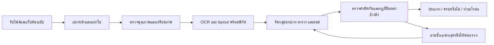

# แบบระบบตรวจใบเสร็จใหม่

วันที่ค้นคว้า: 20 ตุลาคม 2569 (Asia/Bangkok) · ฐาน Desktop 0.6.18 / main `5af0943`

สถานะ: **แบบระบบและต้นแบบกดลองได้ ยังไม่เปลี่ยนแอปหรือเปลี่ยน OCR ที่ใช้งานจริง**
เปิด [ต้นแบบหน้าจอ](prototypes/receipt-review/index.html) ในเบราว์เซอร์ได้โดยตรง ใช้ข้อมูลสังเคราะห์ทั้งหมด ไม่รับไฟล์จริง ไม่เรียก OCR/API และไม่ส่งข้อมูลออก

## ผลลัพธ์ที่ผู้ใช้ต้องเห็น

เหลือเพียงสามคำถามในหน้าหลัก ภาพเอกสารอยู่ข้างกัน กดข้อที่ต้องแก้เพื่อชี้บริเวณต้นฉบับได้

1. **ใบเสร็จประเภทไหน** — แสดงหนึ่งในสี่ประเภทต่อไปนี้ พร้อมปุ่มแก้ประเภท
   - ใบเสร็จรับเงิน/ใบกำกับภาษีแบบเต็มรูป
   - ใบเสร็จรับเงิน/ใบกำกับภาษีอย่างย่อ
   - บิลเงินสด
   - ใบเสร็จรับเงินทั่วไป
2. **องค์ประกอบครบตามการเบิกจ่ายหรือไม่** — `ครบตามเกณฑ์ที่ตรวจ` / `ยังไม่ครบ` / `ยังยืนยันไม่ได้` พร้อมเหตุผลสั้น ๆ และที่มาเมื่อกดดู
3. **ต้องทำอะไรต่อ** — งานที่ทำได้จริง เรียงตามสิ่งที่ต้องแก้ก่อน ระบุใครทำ เช่น “ขอร้านออกเอกสารแก้ไขชื่อผู้ซื้อ” หรือ “ตรวจยอดในภาพก่อนส่งต่อ”

รายละเอียดช่องข้อมูล รายการสินค้า และแหล่งเกณฑ์อยู่ในส่วนพับ ไม่แสดง JSON, raw OCR, คะแนนโมเดล, engine switches หรือรหัสหมวดเบิกบนหน้าหลัก ปุ่มคัดลอก/บันทึกสรุปใช้ข้อความอ่านได้ การส่งข้อมูลไปแชตยังผ่าน privacy/consent gate เดิม

สถานะ “ครบ” เป็นผล pre-check ตามขอบเขตเกณฑ์ที่ระบุ ไม่ใช่อนุมัติเบิกจ่าย ไม่ใช้สีอย่างเดียวสื่อสถานะ ใช้ข้อความและไอคอนควบคู่ รองรับแป้นพิมพ์ การขยายข้อความ หน้าต่างแคบ และ light/dark ตาม `DESIGN.md`

## สิ่งที่ต้องแก้จากระบบเดิม

| ระบบปัจจุบัน                                                                   | แบบใหม่                                                                             |
| ------------------------------------------------------------------------------ | ----------------------------------------------------------------------------------- |
| `receipt.tsx` มี 8 ประเภท และประเภทอยู่ในฟอร์มพับ                              | ผลหลักแสดง 4 ประเภทที่ผู้ใช้กำหนดทันที; สถานะยังระบุไม่ได้เป็น `null`               |
| local PP-OCRv5 + optional line cross-check และ AI vision คนละทาง               | adapter กลาง เก็บตำแหน่ง/หลักฐาน/ความขัดแย้งในรูปแบบเดียวกัน                        |
| มี EXIF, contrast และ overlapping tiles แล้ว แต่ยังไม่มี table-structure model | เพิ่ม document boundary, layout/table parsing และการจับคู่ในขอบเขตเอกสารเดียว       |
| มีการแก้ข้อมูลและ provenance แล้ว                                              | รักษาค่าที่คนแก้; การอ่านซ้ำไม่ทับ และเปลี่ยนเอกสาร/ประเภท/กฎต้องยกเลิกผลยืนยันเดิม |
| เกณฑ์องค์ประกอบทั่วไปกับข้อ AFP อยู่ใน checklist เดียว                         | แยกหลักฐานเอกสาร กฎหมายภาษี และเกณฑ์องค์กรในชั้นกฎ แล้วรวมเป็นคำตอบสั้น             |

อ้างอิง: [workflow เดิม](../desktop/src/receipt-workflow.ts), [compliance เดิม](../desktop/src/receipt-compliance.ts), [OCR เดิม](../experiments/local-thai-ocr/README.md), [form reducer](../desktop/src/receipt-form.ts)

## ประเภทเอกสารและความไม่แน่ใจ

เก็บ `receiptKind` เป็น `full_tax_invoice | abbreviated_tax_invoice | cash_bill | general_receipt | null` และเก็บประเภท/ถ้อยคำที่พบจริงแยกต่างหาก ชื่อประเภทใน UI เป็นกลุ่มตามความต้องการผู้ใช้ ไม่ทำให้ใบกำกับภาษีอย่างเดียวกลายเป็นหลักฐานรับชำระแล้ว ต้องตรวจข้อความ/หลักฐานการรับเงินแยก

ใช้หัวเอกสาร ตำแหน่งคำสำคัญ และโครงสร้างประกอบการจำแนก ไม่ใช้แค่มีคำว่า VAT หรือยอดที่หารภาษีลงตัว ไม่ใช้การมีชื่อผู้ซื้อเป็นเงื่อนไขยกระดับอย่างย่อเป็นเต็มรูป และไม่ลดเอกสารเต็มรูปที่ข้อมูลขาดไปเป็นใบเสร็จทั่วไปเพื่อให้ผ่าน

- ใบเสร็จทั่วไปกับบิลเงินสดบางรูปแบบคล้ายกัน ให้คนยืนยันเมื่อหลักฐานจำแนกไม่พอ
- ใบเสนอราคา สลิปโอน ใบสำคัญรับเงิน ใบลดหนี้ หรือเอกสารอื่นอยู่นอกสี่ประเภทนี้ แสดง “ยังจัดเข้าประเภทใบเสร็จไม่ได้” พร้อมเหตุผล/ขอเอกสารที่เกี่ยวข้อง ไม่บังคับจัดเป็นใบเสร็จทั่วไป
- หลายใบในภาพต้องแยกก่อนจำแนก; หลายหน้าหนึ่งใบต้องรวมเมื่อมีหลักฐานต่อเนื่องที่ชัดเจน
- ผู้ใช้แก้ประเภทได้ แต่ผลเกณฑ์ต้องคำนวณใหม่ ไม่รับรองว่าประเภทถูกเพราะคนเลือกเพียงอย่างเดียว

## องค์ประกอบและแหล่งเกณฑ์

**ข้อจำกัดที่พบจริง:** `finance-disbursement-policy` ใน [ทะเบียนเอกสาร](../manifest/documents.yaml) ยังเป็น `not-provided` จึงยังสรุปว่า “ครบตาม AFP ทุกเงื่อนไข” จากใบเสร็จอย่างเดียวไม่ได้ ทั้งนี้ QP-AF-001/003/004 และหนังสือเวียน AFP ที่ลงทะเบียนแล้วใช้ได้ตามขอบเขตเนื้อหา ห้ามมองว่าไม่มีแหล่งข้อมูลการเงินเลย

ชั้นกฎที่เสนอ:

| ชั้น     | ตรวจอะไร                                                                  | แหล่ง/การจำกัดผล                                                                                                                                   |
| -------- | ------------------------------------------------------------------------- | -------------------------------------------------------------------------------------------------------------------------------------------------- |
| เอกสาร   | ชื่อผู้ออก วันที่ รายการ ยอด หลักฐานรับชำระ; ยอดขัดกัน; ภาพอ่านได้หรือไม่ | ต้นฉบับที่มีพิกัด ออกผลว่าพบ/ขาด/อ่านไม่ได้ ไม่เท่ากับสิทธิเบิก                                                                                    |
| ภาษี     | ข้อความและองค์ประกอบที่เกี่ยวกับเต็มรูป/อย่างย่อ                          | [กรมสรรพากร ม.86/4 และ 86/6](https://www.rd.go.th/5208.html) และประกาศที่ใช้กับกรณีนั้น ต้องระบุรุ่น/วันที่ตรวจและเงื่อนไขเพิ่มเติม                |
| เบิกจ่าย | ผู้ซื้อที่ต้องใช้ ประเภทรายจ่าย โครงการ หลักฐานแนบ วงเงินและอำนาจ         | เอกสาร STeP/CMU ที่ยืนยันและใช้กับรายการนั้น; ขาด source ให้รอตรวจ                                                                                 |
| ส่งต่อ   | เส้นทางดำเนินงานจริง                                                      | [QP-AF-003 §4.2–4.3](knowledge/qp-af-003.md), [QP-AF-004](knowledge/qp-af-004.md), [AFP circulars](knowledge/afp-operational-circulars.md) ตามกรณี |

รายการตรวจเริ่มต้นสำหรับออกแบบ ไม่ใช่ชุดกฎ production ที่อนุมัติแล้ว:

| ประเภท    | หลักฐานที่ต้องจับให้ได้ก่อนตรวจ                                                                               | จุดที่ห้ามเหมารวม                                                                                  |
| --------- | ------------------------------------------------------------------------------------------------------------- | -------------------------------------------------------------------------------------------------- |
| เต็มรูป   | หัวเอกสาร ผู้ออก/ที่อยู่/เลขภาษี ผู้ซื้อ/ที่อยู่ เลขที่/วันที่ รายการ/ปริมาณ/มูลค่า ภาษีแยก และหลักฐานรับชำระ | buyer tax ID/สาขาและเงื่อนไขเฉพาะต้อง resolve ตามประกาศและสถานะคู่ค้า; ไม่เติมตัวตน STeP จากความจำ |
| อย่างย่อ  | หัวเอกสาร ผู้ออก/เลขภาษี เลขที่/วันที่ รายการ/มูลค่า และข้อความรวม VAT                                        | ไม่มีชื่อผู้ซื้อหรือ VAT แยกไม่ใช่เหตุผิดตามเกณฑ์เต็มรูปโดยอัตโนมัติ; เงื่อนไขเบิกองค์กรแยกต่างหาก |
| บิลเงินสด | ผู้ออก วันที่ เลขที่ถ้ามี รายการ ยอด และหลักฐานรับเงินที่ใช้กับกรณี                                           | ลายมือได้; ห้ามสร้างเลขภาษีหรือคิดว่าเป็นใบกำกับภาษีเพราะพิมพ์ยอด VAT                              |
| ทั่วไป    | ผู้ออก วันที่ รายการ ยอด และหลักฐานรับเงินที่ใช้กับกรณี                                                       | รายการบังคับ/ลายเซ็นต้องมี source ใช้กับชนิดเอกสารนั้น; ไม่บังคับลายเซ็นหมึกกับ e-receipt ทุกกรณี  |

`not_detected` หมายถึง OCR ยังหาไม่เจอ ไม่เท่ากับ `missing_confirmed` ที่คนเทียบภาพชัดแล้วว่าไม่มี ข้อมูลที่อ่านขัดกันหรือภาพตัดไม่ให้ตัดสิน “ขาด” ทันที ลายเซ็นที่ตรวจพบยืนยันได้เพียงว่ามีรอย ไม่ยืนยันตัวบุคคล/ความแท้

ทุก rule มี `id/version/sourceRef/sourceStatus/effectiveFrom/effectiveTo/applicability/requiredEvidence` เวลาใช้งานตรวจ source อีกครั้ง การเปลี่ยนกฎทำให้ผลเดิมต้องประเมินใหม่ ไม่มี source หรือเงื่อนไข applicability ไม่ชัดให้ `unknown` ไม่ตีความเป็นผ่าน/ไม่เกี่ยวข้อง

การสรุปสถานะ:

1. พบข้อบังคับที่ใช้กับกรณีนี้และพิสูจน์ว่าขาด/ข้อมูลผิด → **ยังไม่ครบ** พร้อมรายการแก้; แสดงข้อที่ยังยืนยันไม่ได้ควบคู่
2. ไม่มีข้อขาดที่ยืนยันแล้ว แต่มีภาพไม่ชัด ค่าขัดกัน ไม่รู้ประเภท ไม่รู้บริบท หรือขาดเกณฑ์ปัจจุบัน → **ยังยืนยันไม่ได้** พร้อมวิธีปิดแต่ละประเด็น
3. ทุกข้อที่ใช้กับกรณีมีหลักฐานครบ ค่าสำคัญเทียบต้นฉบับแล้ว และ source ยังใช้ได้ → **ครบตามเกณฑ์ที่ตรวจ** พร้อมชื่อ/รุ่นเกณฑ์และขอบเขต

## OCR ที่ค้นพบและข้อเสนอเลือกใช้

**ยังไม่มีผลทดสอบบนชุดใบเสร็จ STeP ที่เทียบกันตรง ๆ จึงไม่มีหลักฐานพอเรียกตัวใดว่าแม่นที่สุดสำหรับงานนี้** คะแนน public benchmark ของแต่ละรุ่นใช้คนละชุดและคนละ metric ห้ามนำเปอร์เซ็นต์มาเรียงแข่งกันหรือแปลงเป็นโอกาสเบิกผ่าน

| ตัวเลือกที่ตรวจจาก upstream                                                      | เหตุผลที่คัดเข้าทดสอบ                                                                                                                                                                                                                                                                                                                        | สิ่งที่ต้องพิสูจน์กับใบเสร็จไทย                                                                                                                                                                                                   |
| -------------------------------------------------------------------------------- | -------------------------------------------------------------------------------------------------------------------------------------------------------------------------------------------------------------------------------------------------------------------------------------------------------------------------------------------- | --------------------------------------------------------------------------------------------------------------------------------------------------------------------------------------------------------------------------------- |
| **PaddleOCR-VL 1.6 (0.9B)**                                                      | โมเดลใหม่ด้าน parsing/layout/table/spotting ในชุด PaddleOCR-VL; model card รายงาน OmniDocBench v1.6 96.33% และ Apache-2.0 [model card](https://huggingface.co/PaddlePaddle/PaddleOCR-VL-1.6)                                                                                                                                                 | คะแนนนี้ไม่ใช่ความแม่นใบเสร็จไทย ต้องวัด Thai fields, ตัวเลข, ตำแหน่ง และ runtime จริง; PP-OCRv6 เป็นอีกรุ่นงาน OCR ห้ามสลับชื่อหรือถือว่ารองรับ Thai เพราะใหม่กว่า [upstream](https://github.com/PaddlePaddle/PaddleOCR)         |
| **Typhoon OCR 1.5 (2B)**                                                         | เน้นไทย/อังกฤษ มี Markdown/HTML table และ self-host weights Apache-2.0 [model](https://huggingface.co/typhoon-ai/typhoon-ocr1.5-2b), [API](https://docs.opentyphoon.ai/en/ocr/)                                                                                                                                                              | งานประเมินของผู้พัฒนาเป็นชุด Thai ภายใน ไม่ใช่ head-to-head receipt benchmark; ข้อความ/HTML ไม่รับประกันพิกัดต่อ field ต้อง anchor กลับภาพ และตรวจ hallucination [evaluation](https://opentyphoon.ai/blog/en/typhoon-ocr-release) |
| **Azure Document Intelligence v4.0, `prebuilt-receipt` + Read/Layout ตามจำเป็น** | เอกสาร official ระบุ Thai ใน receipt และ Read/Layout; ให้ข้อมูลมีโครงสร้าง [languages](https://learn.microsoft.com/en-us/azure/ai-services/document-intelligence/language-support/prebuilt?view=doc-intel-4.0.0), [receipt](https://learn.microsoft.com/en-us/azure/ai-services/document-intelligence/prebuilt/receipt?view=doc-intel-4.0.0) | รองรับภาษาไม่ได้แปลว่าตรงแบบภาษีไทย/AFP; วัด field roles, item rows และต้นทุนทุก operation; ไม่เรียก Layout ซ้ำทุกใบโดยอัตโนมัติ                                                                                                  |
| **Google Document AI Enterprise OCR**                                            | OCR รองรับ Thai และมี image-quality signal [processors](https://docs.cloud.google.com/document-ai/docs/processors-list), [OCR](https://docs.cloud.google.com/document-ai/docs/enterprise-document-ocr)                                                                                                                                       | ต้องมีชั้น grouping/extraction เพิ่ม; Invoice Parser ในรายการที่เปิดตรวจไม่ได้ระบุ Thai ห้ามนำความสามารถ OCR ไปอ้างว่า Invoice Parser รองรับ Thai แล้ว                                                                            |

**ตัวตั้งต้นของแบบ:** ใช้ PaddleOCR-VL 1.6 เป็นผู้สมัครหลักด้านโครงสร้าง และ Typhoon OCR 1.5 เป็นผู้สมัครอ่านภาษาไทย/ตรวจเฉพาะจุด ให้ Azure receipt เป็นผู้สมัคร Cloud พร้อมใช้ เทียบกับ baseline PP-OCRv5 ปัจจุบันก่อนเลือก production champion ไม่ติดตั้ง engine สองตัวลงเครื่องพนักงานทุกเครื่อง และไม่รันทุก engine ทุกใบ

ทางเลือกให้บริการมีสองแบบ ใช้ UI/result contract เดียวกัน:

- **Cloud จัดการให้:** ทดลอง Azure ในโควตาฟรีก่อนและเทียบ Google OCR ตามความเหมาะสม ต้องมีบัญชี/ภูมิภาค/เงื่อนไขข้อมูลที่องค์กรยอมรับ ไม่มีการส่งใบเสร็จจริงในงานออกแบบนี้
- **บริการกลางที่องค์กรโฮสต์:** PaddleOCR-VL/Typhoon อยู่หลัง authenticated gateway ในองค์กรหรือ cloud account ขององค์กร มีต้นทุนเครื่อง/GPU การดูแลและการอัปเดต แม้ไม่มีค่า license ต่อหน้า ความเร็ว/หน่วยความจำบน Windows/Mac ยังต้องวัด ไม่รับรองว่าเครื่องพนักงานรันไหวจากขนาดพารามิเตอร์

เครื่องที่ไม่มีเครือข่ายยังเปิดผลเดิม/ตรวจด้วยคนได้ และใช้ OCR เดิมเป็น fallback ที่แจ้งสถานะชัด หากอ่านไม่ได้ห้ามให้ระบบเปลี่ยนเป็น “ครบ” หรือส่งไฟล์ไป provider อื่นเงียบ ๆ

## ค่าใช้จ่ายและการควบคุม

ผู้ใช้ถามเรื่องค่าบริการ Cloud แต่ยังไม่ได้เลือก provider/วงเงินหรืออนุญาตส่งเอกสารจริง ราคาเป็นข้อมูลที่เปิดตรวจวันที่ข้างต้น ไม่ใช่ใบเสนอราคา และแยกจากแพ็กเกจ Google Workspace

| เส้นทาง               | ราคาที่ตรวจพบ/ข้อจำกัด                                                                                                                                                                                                                                                                |
| --------------------- | ------------------------------------------------------------------------------------------------------------------------------------------------------------------------------------------------------------------------------------------------------------------------------------- |
| Azure                 | [หน้าราคา](https://azure.microsoft.com/en-us/pricing/details/document-intelligence/) ระบุ F0 ฟรี 500 หน้า/เดือน; paid rate ขึ้นกับ region/offer และหน้าเว็บที่อ่านได้ยังแสดง `$-` จึงไม่ใส่ยอดที่เดาเอง; F0 มีขีดจำกัด ต้องตรวจขนาด/จำนวนหน้าต่อคำขอก่อน pilot                        |
| Google Enterprise OCR | [หน้าราคา](https://cloud.google.com/products/document-ai/pricing) ระบุช่วงฟรี 1,000 หน้าแรก จากนั้นอัตรามาตรฐาน $1.50/1,000 หน้าถึง 5 ล้าน; เช่น 10,000 หน้าเข้าเงื่อนไขเดียวกัน = $13.50 เฉพาะ OCR ไม่รวม add-ons/extraction/storage/network/tax ต้องตรวจรอบโควตาและบัญชีก่อนใช้จริง |
| Typhoon API ทดลอง     | เอกสาร [บริการ](https://opentyphoon.ai/model/typhoon-ocr) ระบุ free API 20 requests/minute; ไม่ใช้ free endpoint เป็นหลักประกัน SLA/สิทธิใช้ข้อมูล/บริการ production และตรวจเงื่อนไขอีกครั้งก่อนส่งจริง                                                                               |
| โฮสต์เอง              | ค่า license โมเดลที่ระบุข้างต้นไม่คิดต่อหน้า แต่มี compute/storage/operations รวมถึงค่า cloud GPU หากเช่าเครื่อง                                                                                                                                                                      |

นับ **pages/operations ที่ provider คิดเงิน** ไม่ใช่จำนวนไฟล์: การ crop ซ้ำ, retries และ extraction อีก model อาจมีค่าใช้จ่ายเพิ่ม ทำ local quality gate ก่อนส่ง, hash/cache ภายในขอบเขตผู้ใช้, จำกัดหนึ่ง primary pass และหนึ่ง targeted recheck เฉพาะที่จำเป็น ตั้ง hard quota ที่ gateway (ไม่ใช่ budget alert อย่างเดียว) เมื่อถึงเพดานหยุด/ให้ตรวจด้วยคน ไม่โยกไปบริการเสียเงินอื่น

ก่อนเรียกจริงแสดงปลายทาง จำนวนหน้า และขอบเขตข้อมูลให้ผู้ใช้เห็น รับ consent ตาม policy ที่ใช้ เก็บ secret ใน host/Vault ไม่ใส่ renderer หรือ shared key ใน installer; provider/model เปลี่ยนต้องตรวจสิทธิใหม่ ห้ามส่งเต็มเอกสารหากได้รับอนุญาตเฉพาะ crop ห้าม raw receipt/PII อยู่ใน log

## Pipeline เตรียมภาพ → OCR → Grouping



### 1. รับไฟล์และแยกเอกสาร

ตรวจ MIME/magic bytes, ขนาดไฟล์, จำนวนหน้า/decoded pixels และ decompression limits ที่ host; รักษาเพดานเดิมหรือย้ายขีดจำกัดพร้อม regression ไม่ปล่อย renderer เลือก path ใดก็ได้ เก็บ immutable original + hash ใน job scope; มี cancel/timeout/cleanup และไม่ persist receipt โดยปริยาย

PDF แยกต่อหน้า: ใช้ native text + coordinates เมื่อเชื่อถือได้ แต่ตรวจว่ามีภาพ/บริเวณไม่มี text หรือ text layer ที่อ่านไม่ได้; mixed PDF ต้อง OCR เฉพาะส่วนที่ขาด ไม่เลือก text layer ทั้งไฟล์เพียงเพราะหน้าแรกมี text ตรวจภาพต้นฉบับเทียบเมื่อยอด/ตำแหน่งขัดกัน

แยกหลายใบในหน้าเดียวด้วยขอบกระดาษ/ช่องว่าง/layout สร้าง `documentId` ต่อใบ ให้ผู้ใช้แยก/รวมด้วยคนได้เมื่อไม่ชัดเจน ห้ามรวมเพราะชื่อร้านเหมือนกันหรืออยู่ไฟล์เดียวกัน การรวมข้ามหน้าต้องมีเลขเอกสาร ตัวตนผู้ออก และสัญญาณหน้าต่อเนื่องที่ไม่ขัดกัน; ถ้าขาดให้เสนอรวมโดยรอคนยืนยัน

### 2. Pre-process ที่ไม่ทำลายหลักฐาน

- เริ่ม EXIF orientation; ตรวจ 0/90/180/270°, deskew มุมเล็ก และ perspective correction เมื่อเห็นขอบเอกสาร เก็บภาพก่อน/หลังและ inverse transform กลับต้นฉบับ
- PDF scan เริ่มทดสอบที่ 300 DPI สำหรับตัวพิมพ์เล็ก โดยมี pixel budget; ภาพโทรศัพท์ไม่ upscale โดยไม่มีเหตุ ใช้ crop/tiles แบบ overlap สำหรับใบยาว และต้องมี dedup กลับพิกัดเดียว
- ประเมิน blur/glare/clipped edges/text height/low contrast ก่อนปรับ เลือก bounded denoise/contrast/illumination correction เท่าที่จำเป็น ทดสอบกับภาพต้นฉบับเสมอ
- ห้าม generative fill, inpainting หรือ super-resolution ที่แต่งเส้นตัวอักษรเป็นหลักฐานใหม่ และห้าม threshold/denoise รุนแรงจนลบจุดทศนิยม/วรรณยุกต์/เครื่องหมายลบ
- ถ้าภาพขาด/แสงสะท้อนทับยอด ให้ขอถ่ายใหม่ทันที ไม่ให้โมเดลเดาส่วนที่มองไม่เห็น
- ผลทุก variant เก็บ `variantId`, ขนาด, transform, quality flags และ engine/model revision; หลาย variant ของใบเดียวไม่ใช่หลายใบเสร็จ

### 3. OCR และ representation กลาง

adapter ให้ tokens/lines/polygons, reading order, block type, table cell row/column/span ถ้ามี และ source-native confidence แยกตาม engine ไม่เอาคะแนนคนละ engine มาถัวเฉลี่ยเป็นความจริง Markdown/HTML จาก VLM เป็น untrusted data; parse เป็น text/cells โดยปิด scripts/external resources และไม่ execute instruction ที่อยู่ในใบเสร็จ

field ที่เสนอทุกตัวอ้าง `documentId/pageId/regionId/tokenIds` และ polygon บน **ต้นฉบับ** หากมีเพียงข้อความไม่มีพิกัด ต้อง align กลับ OCR tokens แบบมีข้อจำกัด; align ไม่ได้ให้ `unanchored` ห้ามสร้างพิกัดโดยเดาหรือแสดงเป็นยืนยันแล้ว

### 4. Grouping ตามบริบทและตำแหน่ง

ทำตามลำดับ **page → document → region → role → row/cell → field** เก็บการเชื่อมโยงใน evidence graph ไม่ทำ text flatten ก่อนจับ field

| กลุ่ม          | วิธีจับคู่                                                                                          | การกันจับผิด                                                                                        |
| -------------- | --------------------------------------------------------------------------------------------------- | --------------------------------------------------------------------------------------------------- |
| ผู้ออก/ผู้ซื้อ | หัวเอกสาร label ผู้ขาย/ผู้ซื้อ ที่อยู่และเลขภาษีใน region ของตน                                     | ใกล้กันอย่างเดียวไม่พอ; ไม่ดึง buyer tax ID ไปเป็น issuer ID; เก็บสาขาแยก                           |
| รายการสินค้า   | table columns + baseline/vertical overlap + reading order; ชื่อหลายบรรทัดอยู่ cell เดิม             | คง row/col/span; จำนวน/ราคาต่อหน่วย/ยอดต้องไม่ข้ามแถว; รองรับไม่มีเส้นตารางและภาษาไทยปนอังกฤษ       |
| ยอด            | label และ amount ใน total region พร้อม subtype subtotal/discount/service/VAT/total/paid/cash/change | VAT rate ไม่ใช่ VAT amount; เงินรับ/เงินทอนไม่ใช่ยอดสุทธิ; ถ้ามีสอง total ให้เก็บทั้งสองและรอตรวจ   |
| หน้า/ใบซ้ำ     | original hash + normalized identity + crop overlap                                                  | หน้าเดียวกันที่อ่านซ้ำ/tile ซ้ำ dedup ได้; เอกสารซ้ำคนละไฟล์แค่เตือน ไม่กล่าวหาหรือยืนยันว่าเบิกซ้ำ |

การจับคู่ใช้ label/role/relative geometry ร่วมกัน มี candidate และ rejection reasons ไม่ใช้ nearest-neighbor ทั่วหน้าอย่างเดียว กรณี ambiguity ให้แสดงจุดตรวจแทนบังคับเลือก

### 5. Normalize, validate, targeted recheck

เก็บ raw string ควบคู่ normalized value: ไทย→อารบิก, วันที่ พ.ศ./ค.ศ., decimal และ currency โดยไม่เดารูปแบบวันที่กำกวม เลขภาษี/เลขที่เอกสารเก็บเป็น string รักษาเลขศูนย์นำหน้า ใช้ decimal/integer minor units ตรวจยอด ไม่ใช้ float tolerance กลบความผิดหนึ่งสตางค์

ตรวจ ID format/checksum ได้ แต่ไม่เท่ากับยืนยันผู้เสียภาษีกับ registry ตรวจสมการที่ตรงกับยอด/ส่วนลด/วิธีภาษีที่เอกสารระบุ ไม่สมมติ VAT 7% หรือเติมยอดที่หายเพื่อให้สมการผ่าน ถ้าคำนวณใช้ค่า OCR ยังไม่ตรวจ ผลคำนวณต้องระบุเป็นเงื่อนไข

เลขภาษี วันที่ เลขเอกสาร ยอดสุทธิ/VAT และ field ที่ rule บังคับเป็น critical fields ต้องตรวจหาความขัดแย้งแม้ primary confidence สูง ส่ง crop ที่ยังมี label/context ไปอ่านซ้ำได้เมื่อ consent ครอบคลุม เก็บค่าขัดกันทั้งสอง หากไม่ลงรอยให้คนเทียบภาพ ไม่ใช้เสียงข้างมากรับรองข้อมูล

## Result contract และวงจรงาน

```text
ReceiptReviewV2
  jobId, sourceHash, generation, ruleSetVersion, modelRevisions
  documents[] { id, pages[], originalRegions[], receiptKind, kindEvidence[] }
  fields[] { documentId, role, key, raw, normalized, candidates[], evidenceRefs[],
             readingState: present | not_detected | illegible | conflict | unanchored,
             reviewState: extracted_unverified | user_input | source_checked }
  checks[] { ruleId, applicability, status: pass | fail | unknown | not_applicable,
             evidenceRefs[], sourceRef, reason }
  summary { kind, completeness: complete | incomplete | needs_review,
            scope, reasons[], nextActions[] }
  paymentApproved: false
```

`not_applicable` ต้องมีเหตุผลตามเกณฑ์ ข้อมูลจาก OCR/AI เริ่ม unverified การกด consent หรือโมเดลสองตัวตอบเหมือนกันไม่เปลี่ยนเป็น source_checked การแก้ด้วยมือโดยไม่เทียบภาพเป็น user_input ตาม [receipt Skill](../skills/common/receipt-audit/SKILL.md)

`received → preprocessing → reading → grouping → checking → needs_review/finished` มี `cancelled/failed` ทุกช่วง ผูก async response กับ job/source hash/generation ไม่ให้ผลเก่าทับไฟล์ใหม่; คนแก้ field ต้องชนะผล recheck ที่มาทีหลัง เปลี่ยน field/type/grouping/source/rules ต้อง invalidate checks ที่พึ่งค่านั้นและผล “ครบ” การ retry ไม่สร้าง job จ่ายเงินซ้ำโดยไม่จำเป็น และ reload ไม่ replay cloud request

## Benchmark เพื่อเลือกตัวที่แม่นที่สุดกับงานนี้

งานออกแบบนี้ **ยังไม่ได้รันโมเดลใหม่หรือวัดความแม่นจริง** ต้นแบบและ synthetic regressions พิสูจน์ flow ได้ แต่ไม่ใช่หลักฐาน OCR accuracy

ข้อเสนอชุดทดสอบ: เริ่ม pilot ที่ได้รับอนุญาต 50 ใบเพื่อหาปัญหา แล้วทำชุดอย่างน้อย 400 ใบ (อย่างน้อย 100 ต่อประเภท) พร้อมเอกสารนอกประเภท มีหลายร้าน/layout ไม่ใช้ใบหรือ template ร้านเดียวกันข้าม tuning/test; แยก locked test ก่อนปรับ prompt/threshold จำนวนนี้เป็นเป้าทดลอง ไม่ใช่การรับรองความเพียงพอทางสถิติ

ครอบคลุมกระดาษความร้อนซีด ถ่ายเอียง/โค้ง/สะท้อน แสงน้อย ลายมือ ตารางหลายบรรทัด ไทยปนอังกฤษ เลขไทย วันกำกวม ส่วนลด/ทอน/บริการ ตัวเลขใกล้กันสองยอด ภาษีผู้ซื้อใกล้ผู้ออก หลายใบหนึ่งภาพ หน้าต่อและหน้าไม่เกี่ยวกัน text PDF/mixed PDF ขอบตัด และเอกสารที่ข้อมูลไม่ครบจริง

ผู้ตรวจสองคนทำ ground truth ของประเภท/field/roles/rows/polygons/ความอ่านได้ ข้อขัดแย้งให้ AFP/ผู้รับผิดชอบตัดสิน เก็บ label “อ่านไม่ได้” ได้ ไม่สร้างคำตอบที่รูปไม่มี เปรียบเทียบ baseline และ candidate บน input/resolution/budget เดียวกัน รายงาน sample count และ confidence interval แยกแต่ละประเภท/คุณภาพ

| ตัววัด          | เกณฑ์เสนอสำหรับ pilot gate (ยังไม่ใช่ผลที่ได้)                                                                                                             |
| --------------- | ---------------------------------------------------------------------------------------------------------------------------------------------------------- |
| ประเภท          | precision/recall/macro F1 แยกสี่ประเภท พร้อม abstention/out-of-scope; macro F1 ≥ 98% บน locked set                                                         |
| Critical fields | exact match แยกยอด/ภาษี/เลขที่/วันที่; ≥ 99.5% ต่อ field ในกลุ่มอ่านอัตโนมัติ พร้อม coverage; ความผิดหนึ่งหลักหรือหนึ่งสตางค์นับผิด                        |
| Grouping        | issuer↔buyer, row/cell association F1 ≥ 99%; รายงาน cross-document leakage แยก และต้องไม่มีในชุด adversarial gate                                          |
| ความครบ         | precision/recall ต่อ pass/fail/unknown; **พบ false-complete แม้หนึ่งเคสใน gate ต้องแก้ก่อนเปิดใช้**; รายงานช่วงความเชื่อมั่น ไม่อ้างว่า zero error ในอนาคต |
| ภาระผู้ใช้      | review rate, เวลาแก้ต่อใบ, ความผิดที่เงียบ; รายงานควบคู่ accuracy ป้องกันการ abstain ทั้งหมดแล้วได้คะแนนสวย                                                |
| ปฏิบัติการ      | end-to-end p50/p95, peak RAM/VRAM, failure rate, cost ต่อ 1,000 ใบรวม crop/retry และทดสอบ Windows/Mac/เครือข่ายจริง                                        |

แยกการทดลอง preprocessing/grouping ablation เพื่อพิสูจน์ว่าช่วยจริง ผู้ชนะต้องผ่าน critical/grouping/false-complete gates ก่อนเทียบความเร็วและต้นทุน หากไม่ผ่านให้คง review-required และไม่ประกาศว่าแม่นที่สุด การเลือก threshold และรุ่น production บันทึกเป็น decision ใหม่พร้อมผล locked test

## แผนพัฒนาต่อและการย้ายระบบ

1. เพิ่ม `ReceiptReviewV2` และ pure summary/rule engine หลัง adapter พร้อม regression: full invoice ขาดผู้ซื้อไม่ downgrade, อย่างย่อไม่โดนกฎเต็มรูป, missing source ไม่ครบ, unreadable ไม่เท่ากับไม่มี, VAT rate/เงินทอนไม่เป็น total, ไม่ปะปน issuer/buyer/ใบ/แถว, async ไม่ทับ manual edit
2. เพิ่ม preprocessing/coordinates + layout adapter; ทดลองแต่ละ engine หลัง capability/consent gate เดิม จัดเก็บ benchmark นอก public repository และไม่ bundle weights/key ใน installer
3. เปลี่ยน `receipt.tsx` เป็นสามคำตอบและ source focus ตามต้นแบบ; ใช้ English locale, light/dark/narrow/keyboard, native Electron handoff ที่อ่านได้ ไม่มี JSON ใน alert
4. pilot + source review กับ AFP แล้วเปิดใช้แบบควบคุม มี rollback เป็นระบบเดิมที่ไม่เปลี่ยนข้อมูลที่คนแก้ เก็บ legacy result เป็นอ่านอย่างเดียวและให้ประเมินใหม่ ไม่แปลง checked เดิมให้เป็น V2 complete

การเปลี่ยน production ต้องผ่าน Desktop format/unit/build, relevant Electron receipt smokes และ exact-head CI ตาม `AGENTS.md`; เปลี่ยน Skill/registry ต้องผ่าน Harness/validator และ knowledge floor เดิมด้วย PR นี้เป็น design handoff จึงไม่มี runtime migration, API billing หรือ release ใหม่

## วิธีตรวจต้นแบบ

เปิด `docs/prototypes/receipt-review/index.html` ใน Chromium/Chrome/Edge ทดสอบ scenario: ขาดข้อมูล, อ่านไม่ชัด, รอเกณฑ์, ครบตามเกณฑ์จำลอง, ยอดขัดกัน, หลายใบ และเอกสารนอกประเภท สลับครบสี่ประเภท กดประเด็นชี้ภาพ สลับกลุ่มใบ และใช้ Tab/Enter/Escape ตรวจแบบแคบ/มืด ทุกค่าเป็น fixture; “เกณฑ์จำลอง” ไม่ใช่ source ปัจจุบันของ AFP

ผลตรวจจริงของต้นแบบและข้อจำกัดบันทึกใน `docs/progress.md` ใน PR เดียวกัน
